# Abstract

This project develops a moderated Learning Management System for a secondary school whose computers are limited and whose internet connectivity cannot be assumed. It follows the Waterfall life cycle with V-Model verification/validation, as required by the National University of Lesotho CS4433 individual assignment. Four categories of school user—Student, Lecturer, Head of Department and Administrator—authenticate to a local C++17 console application and operate on an SQLite database. The administrator controls staff and student accounts, course assignment and enrolment. Lecturers configure assessment deadlines, authorise individual extensions and provide marked feedback. Students may submit or replace on-time work and inspect only released assessments. Departmental HoDs review marks, reject mistakes for re-marking and approve releases. The grade-calculation policy deducts 10% of the available mark per late day for up to three days and assigns zero after that, while still storing late submissions. Every grade adjustment is auditable.

The report preserves the student's submitted planning, requirements and layered architectural decisions, completes the omitted Phase 3 design artefacts and documents the implemented Phases 4–8. The v1.1 change request permits a lecturer to extend the deadline of an entire class and shows the effective deadline on the student's assignment list without cancelling a later individual extension. The local CTest executable reports 15 passing test groups. GCC gcov measures 96.86% of 637 instrumented physical lines in the formatted `src/lms.cpp`, with no claim of full branch coverage. Limits—including absent school acceptance sign-off, unmeasured 50-session capacity, no hosted CI evidence, and a public service timestamp parameter that must not be exposed to untrusted clients—are stated to avoid misrepresenting prototype readiness.

# 1. Introduction

## 1.1 Problem context and objectives

The project responds to the case study of a secondary school that needs assessment workflow controls while retaining simple, offline operation. The school must protect assessment information from premature disclosure, avoid untraceable changes and allow teachers to manage exceptional deadlines. A straightforward grade-book application is inadequate because the mark exists in distinct states: the lecturer has entered it, the HoD has moderated it and the school has authorised student disclosure. The system therefore needs an explicit lifecycle, access rules and a durable record of changed grades. Its main aim is not to provide every feature of a large commercial LMS; the assignment rules out online payments, video calls, plagiarism checking, automated assessment and web/mobile interfaces.

The engineering objectives are to implement authentic C++17 object orientation, demonstrate inheritance and polymorphism through the four user types, encapsulate the late policy using Strategy, persist data with constrained SQLite tables, apply role restrictions, test the critical assessment paths and maintain a versioned change request. The test plan follows a V-Model mapping: requirements are validated by system/acceptance scenarios, design is checked through integration, and individual business policies are verified through unit tests. The user interface remains a console application as specified by the student's original Phase 3 rather than being replaced with a GUI, web application or network server.

## 1.2 Scope, method and deliverables

The target deployment is a protected school computer with a local database. The application can operate without a network connection after dependencies and executable are installed. Staff and students use individual login credentials. Assignment content is text in this prototype, avoiding binary upload infrastructure and the security issues of arbitrary attachments. A teacher can enter or adjust a raw mark and written feedback; the system computes the grade after the late penalty. An authorised HoD must moderate the result before release. The project separates a documented v1.0 base workflow from the v1.1 perfective feature requested in Phase 8.

The development plan has eight phases. The student's original submitted files are preserved unchanged in `original_phases/`, providing evidence of the first phase decisions and the original use case. This integrated report reexpresses those choices, completes Phase 3's detailed design requirements, and then explains the source, tests, quality controls, deployment, maintenance and ethical responsibilities. Where an engineering artefact is referenced by file path, the actual file is supplied in the accompanying project archive. This includes editable `.puml` diagrams, corresponding PNGs, SQL schema, source, test code, CI workflow and evidence logs. The application is a demonstration-grade prototype until institutional operations and security gaps are addressed.

# 2. Phase 1 — Project Planning and Management (10 marks)

## 2.1 Feasibility and recommendation

The submitted feasibility study recommended proceeding with a lightweight offline console application written in C++17 with an SQLite data store. **Technical feasibility** is supported by availability of free compilers, CMake, SQLite, OpenSSL and unit-test tooling. The implementation uses local storage, so unreliable internet does not interrupt normal marking or student submission after installation. **Operational feasibility** depends on readable prompts and role-specific commands. This approach reduces visual complexity for school staff, although the school should verify that non-technical users can complete routine tasks without assistance. The console is cheaper to maintain than a custom web server and directly supports the case-study scope.

**Economic feasibility** follows from avoiding subscription/cloud fees and using existing school computers and open-source dependencies. The major expense is development, support and the time teachers spend learning the commands. **Legal feasibility** requires controls over learner data and assessment records. Because the likely school jurisdiction is Lesotho, the appropriate local primary reference is the Data Protection Act as published in 2012; South Africa's POPIA should not automatically be substituted merely because it was mentioned in the preliminary Phase 1 plan. **Schedule feasibility** is conditional on the project's seven-week window and the Gate 2 rule: design approval is needed before implementation. The conclusion is to proceed as a single-host system, with limitations identified before operational deployment rather than obscured.

## 2.2 Work breakdown, schedule and critical path

The student's submitted Work Breakdown Structure separates planning, requirements, system design, implementation, verification, deployment, maintenance and final reporting. The included Gantt schedule places planning in the first week; requirements in weeks 1–2; detailed design in weeks 2–3; implementation in weeks 4–5; testing in weeks 5–6; deployment in week 6; and maintenance, completion and viva preparation in week 7. This respects the assignment's phase-gate principle. Milestones include Gate 1 (requirements agreement), Gate 2 (design approval and permission to implement), Gate 3 (verification/validation review), v1.0 and v1.1. A critical dependency chain is requirements approval → design approval → executable implementation → integration/system testing → baseline release → CR1 implementation/regression → final package. Delays on this chain cause corresponding delivery delays unless work is legitimately resequenced within the Waterfall restrictions.

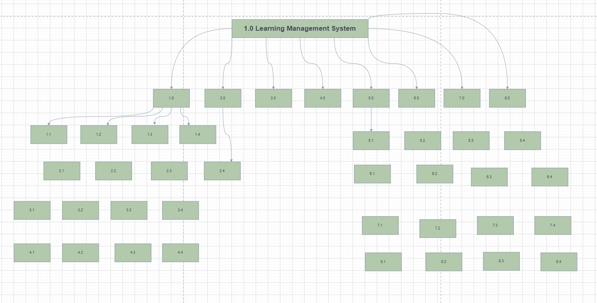{width=90%}

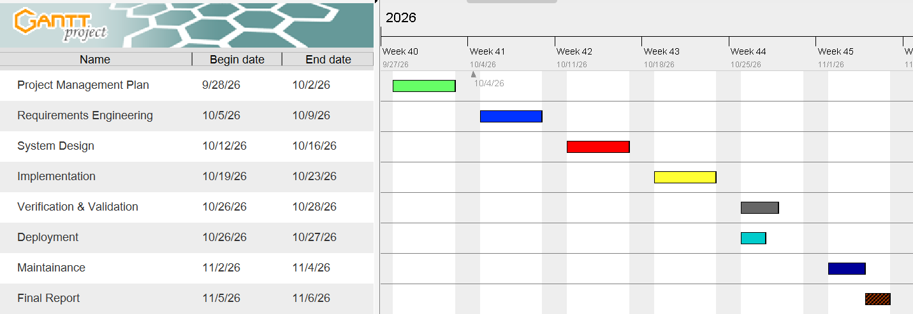{width=90%}

## 2.3 Risk management and gates

Six risks were assessed in the submitted Phase 1 register using exposure `likelihood × impact`, with each dimension on a 1–5 scale. **R1 scope creep from conflicting requests** had 4 × 4 = 16 and required formal change control and early conflict resolution. **R2 underestimated moderation complexity** had 3 × 4 = 12, requiring early validation of rules and prioritisation of Must requirements. **R3 SQLite degradation at 800 students** had 2 × 4 = 8, mitigated through parameterised queries, appropriate indexes and performance testing. **R4 password-storage vulnerability** had 3 × 5 = 15, mitigated by using a recognised cryptographic library and security review. **R5 developer unavailability** had 3 × 5 = 15, requiring complete work notes and contingency arrangements. **R6 misunderstanding late penalty/extension semantics** had 3 × 4 = 12 and required documented interpretation and boundary testing.

At Gate 1 the major residual concerns were R1 and R6: the principal's release embargo took precedence over the lecturer's desire to show marks immediately; school late penalties were made precise and extensions allowed. At Gate 2 design control reduced R2 through an explicit state machine and `LatePenaltyStrategy`, and R4 through a salted hash format. At Gate 3 the remaining technical concerns were tested grade visibility, audit reliability and penalty correctness. The updated register in the appendix adds unresolved R7 (public service time argument and reliance on host clock), R8 (50-session performance) and R9 (unaudited host-level database edits). These are especially important because tests can establish algorithmic correctness without demonstrating safe use in a real school environment. Exposure values are working estimates; they are not measured probabilities.

# 3. Phase 2 — Requirements Engineering (14 marks)

## 3.1 Stakeholders and conflict resolution

The original Phase 2 identifies six stakeholder groups: principal, lecturer, HoD, student representative, IT officer and administration. Each prioritises a different dimension of the same workflow. The principal values control and usability, the lecturer fast return and flexible deadlines, the HoD departmental oversight and strict deductions, students fair resubmission and written feedback, IT officers offline reliability and protected credentials, and administrators manageable accounts and course membership. The core dispute is the lecturer's wish for immediate publication against the principal's prohibition on pre-moderation disclosure. The agreed business rule is that the lecturer may record and edit a provisional grade but **only the HoD can release it**, at which point students see the approved score and comments.

The second conflict is between the HoD's punitive late schedule and the student representative's concern that late work must not simply be refused. It was resolved by accepting late work, flagging it, and calculating a grade penalty (zero after three days), rather than refusing storage. Students may replace a submission before the individual effective deadline; this replacement updates the current submission row. A lecturer may grant a documented individual extension that shifts the penalty and resubmission boundary. The offline requirement is resolved through a locally installed executable and database rather than the internet. Security and performance are to be mostly invisible to nontechnical staff; the application must authenticate safely and return understandable errors.

## 3.2 Requirements baseline and verification

The student's Phase 2 SRS has **17 Must functional requirements**, recorded here as `FR-01` through `FR-17` in the order written in the original document. These cover login (FR-01); administrator account CRUD (FR-02), lecturer/course enrolment (FR-03) and department/course management (FR-04); four-role access restriction (FR-05); assignment creation (FR-06); individual extensions (FR-07); student submission/resubmission (FR-08); late policy (FR-09); marks/feedback (FR-10); HoD review (FR-11) and release (FR-12); released student results (FR-13); mark change audit (FR-14); enrolled assignment listing (FR-15); offline operation (FR-16); and salted password hashes (FR-17). The proposed Phase 8 additions are `FR-18` class extension and `FR-19` visible effective deadline and source. These identifiers formalise the originally unnumbered rows and are carried consistently into `docs/traceability.csv`.

The Must non-functional baseline requires 800-user login within two seconds, responsiveness of user actions within two seconds at up to 50 concurrent local sessions, protected password storage, full offline usability, complete mark-change audit, zero high-severity SQL injection warnings and graceful error handling. The Should usability goal is 90% nontechnical user completion of a login/assignment/submission flow within five minutes after reading the guide. These are measurable criteria, not aspirational adjectives. Performance and usability criteria must not be claimed met without appropriate timing or observed participants; they are carried as unresolved verification obligations in the project matrix. The 50-session target, in particular, may require a supervised shared-host design or an approved server layer, beyond the current single-host console prototype.

## 3.3 Use cases, exception paths and acceptance criteria

The original use case diagram connects Student to Submit Assignment and Resubmit Assignment; Lecturer to Create Assignment, Grant Individual Extension, Mark Submission and Write Feedback; HoD to Review/Moderate/Release marks; and Administrator to Manage Users, Assign Lecturers and Enrol Students. The planned system also includes department/course management and results visibility. Three fully dressed use cases are important because they provide direct acceptance-test sources. **Submit Assignment:** preconditions are authenticated student, enrolment and existing assignment. Main flow selects the assignment, displays due/max-mark details, accepts nonempty text and stores timestamp and Submitted/Late status. Alternative flows allow pre-deadline replacement and first-time late submission; exception flows reject invalid content or handle a database error without crashing. Postcondition: durable row with deadline-derived status. **Grant Individual Extension:** authorised lecturer selects enrolled student and assignment, chooses a deadline later than the original and records a reason; an invalid date or nonexistent student is rejected. Postcondition: a student-specific due date appears in the assignment list and governs late penalties. **Moderate and Release:** HoD in the correct department reviews a Marked record, approves/adjusts with a reason or rejects for re-marking; all changes are logged. Release of the course results makes approved feedback visible to the respective students only.

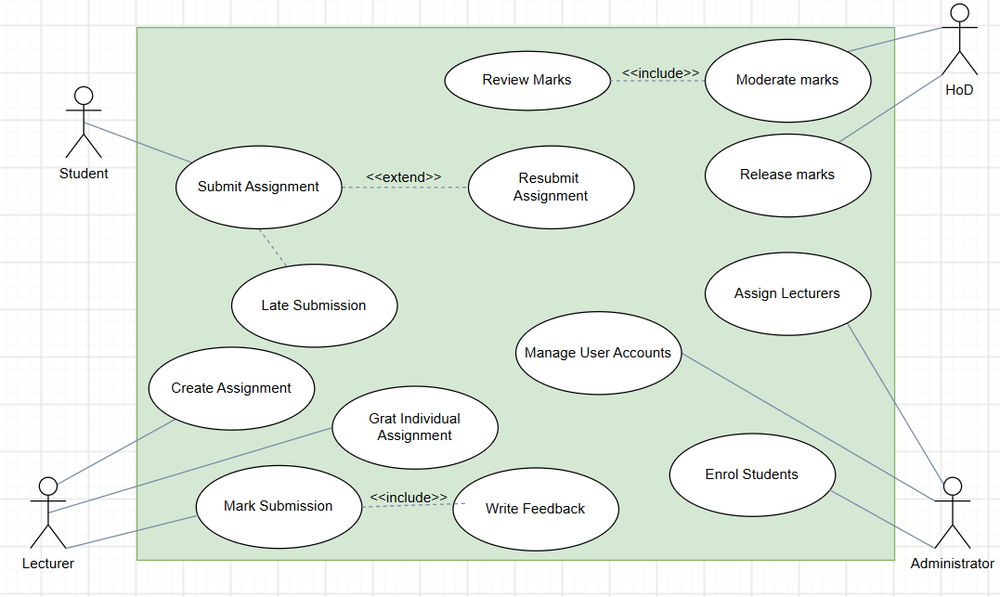{width=89%}

The acceptance criteria derived from these use cases are observable: before release, `releasedMark` returns no value; after an authorised release, it returns the moderated mark and feedback for the appropriate student only. A wrong-department HoD cannot alter the grade. A submitted student's replacement before deadline does not create a duplicate row. Work one second after a deadline is accepted and is penalised by 10% of the maximum; work one second after 72 hours is stored but graded zero. A successful audit record for a mark change includes the actor, previous/new values and explanatory reason. The requirements traceability appendix identifies each corresponding design operation, table, source file and test group; the original Phase 2 document remains available unchanged in the project package.

# 4. Phase 3 — System Design (24 marks)

**Project:** Moderated Learning Management System (LMS) | **Student:** Chefa T. J. (202100088)  
**Baseline:** Submitted Phase 1, Phase 2 and Phase 3. **Implementation design:** console application, C++17, SQLite, four-layer architecture. **Design status:** detailed v1.0 baseline with v1.1 extension shown separately.

## 3.1 Architecture and justification (5 marks)

The system uses the **layered architectural style** selected in the student's original Phase 3 document. Layers depend only on the next lower layer: presentation (`src/main.cpp`), business services/domain rules (`LmsService`, polymorphic `User` and derived types, penalty policy and observers), persistence abstraction (`Database`, `Statement`, `SubmissionRepository`) and SQLite file storage (`school.db`). The console requests service operations; it does not construct SQL statements. Policy and access rules are enforced again in the service, so a forged UI request cannot bypass authorization.

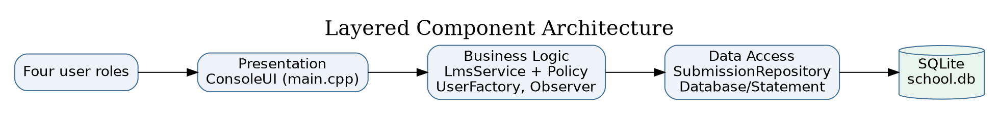{width=95%}

**Why layered:** limited infrastructure on an offline school computer; explicit boundaries keep the CLI replaceable and make business rules testable. **Rejected alternative:** Model–View–Controller was considered but its additional view/controller separation would be disproportionate for a linear console program with no parallel graphical views. A client/server architecture was also not adopted because it would introduce a server, network authentication and additional operational costs that the case study does not require. The proposed executable is a **single-host application**, not a 50-remote-client LAN server; the SRS's 50 concurrent sessions target remains unverified without an additional deployment architecture.

**Dependency rule:** `main.cpp → LmsService → repository/SQL abstraction → SQLite`. `StandardLatePenalty` and `UserFactory` are business components; the `AuditService` observer uses the database abstraction for transactional audit events. Read-only diagnostic SQL in the test code does not represent production access from the presentation layer.

## 3.2 Detailed class diagram and design patterns (7 marks)

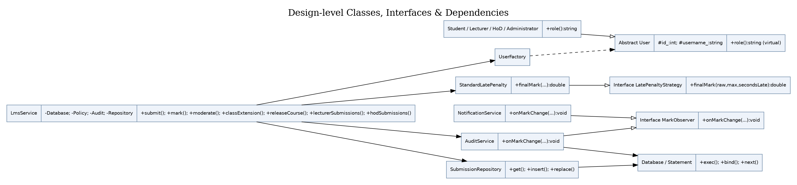{width=95%}

`User` is an abstract base class containing protected `id_` and `username_`, and a pure virtual `role()` method. `Student`, `Lecturer`, `HoD`, and `Administrator` derive from it (generalisation, one concrete role per runtime user). `UserFactory::create` returns `unique_ptr<User>` according to the row's role discriminator. **Factory** centralises role-based instantiation; code invoking `role()` relies on polymorphism, not scattered inheritance-specific constructors.

`LatePenaltyStrategy` declares `finalMark(raw, maximum, secondsLate)`; `StandardLatePenalty` implements the policy. For an on-time submission, the final mark is the raw mark. For late work: `days = ceil(late_seconds / 86400)`; if `days` is 1, 2 or 3, deduct `days × 0.10 × maximum` from the raw mark, clamped at 0. Beyond three days, the result is 0. This interpretation deducts 10% of **available maximum**, not 10% of the student's earned raw mark. **Strategy** makes replacement of the school policy possible without rewriting marking.

`MarkObserver` is an interface. `AuditService` and `NotificationService` implement it. The marking service invokes the audit observer within its SQL transaction and invokes the in-memory notification observer after commit; the latter does **not** constitute persistent or student-visible messaging. **Observer** permits logging/notification side effects to be separated from grade calculations. `SubmissionRepository` offers `get`, `insert`, and `replace` over parameterised SQL and separates a coherent persistence workflow from the service. `Database` owns the SQLite connection and `Statement` owns a compiled query, using RAII to release resources. The broader SQL operations are currently encapsulated inside `LmsService` through this data-access wrapper; introducing dedicated repositories for *all* tables would further strengthen strict layering in a larger deployment.

**SOLID mapping:** Single Responsibility: SQL lifetime (`Database`/`Statement`), penalties (`StandardLatePenalty`), and console UI (`main.cpp`) differ. Open/Closed: new policy subclasses can be added behind the strategy interface, although the current concrete member in `LmsService` would need dependency injection to swap at runtime. Liskov Substitution: concrete users implement the same `role()` contract. Interface Segregation: observer and penalty interfaces are focused. Dependency Inversion: the policy contract and observer contracts are abstract; DB connectivity remains a concrete dependency, explicitly a practical compromise for the small offline application.

**Review/read use cases:** `LmsService::lecturerSubmissions` and `LmsService::hodSubmissions` provide role-scoped lists of submission IDs, content, grading state and available feedback so users can identify records before marking or moderation. The HoD query is restricted to their department, and the lecturer query to assigned courses.

**Key associations/multiplicities:** one department owns zero or more courses and may have multiple users; one course has many assignments; students and courses associate many-to-many through `enrolment`, as do lecturers and courses through `course_lecturer`; an assignment has zero or many submissions; each student has at most one active submission per assignment; a submission has zero or one mark; each mark has zero or more audit events; assignment/student pairs have at most one individual extension; from v1.1, each assignment has at most one current class extension. All composite foreign keys are physically enforced through keys and uniqueness rules in the schema.

## 3.3 Behavioural models (7 marks)

### Submission state machine

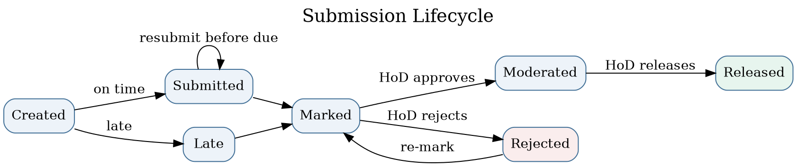{width=95%}

`Created` represents a conceptual pre-submission state, **not a persisted status**. Persisted states are `Submitted`, `Late`, `Marked`, `Moderated`, `Released` and `Rejected`. A first submission after the effective deadline is accepted and stored as Late, even if more than three days overdue (its computed final mark is then zero). A submitted record may be replaced only if it was submitted on time and the replacement also occurs before the effective deadline; it cannot be resubmitted after marking. Rejected is a moderation outcome to allow lecturer re-marking, **not** a denial of late submission. A student may read marks only in Released state.

### End-to-end activity diagram with swimlanes

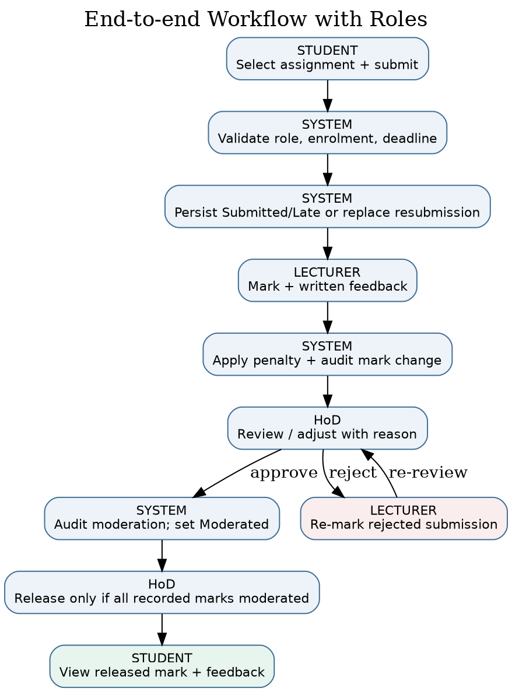{width=70%}

Swimlanes separate actions by Student, System, Lecturer, and HoD. Submission validation guards the persistence path; the service determines effective deadline, persists or replaces the work and acknowledges receipt. The lecturer records raw marks and feedback. The system calculates any late deduction and saves both mark and audit record. The HoD can approve with a required reason, or reject for re-marking. Release cannot occur while recorded marks in the course are still marked or rejected. This does not claim completion of every missing/unsubmitted assignment: it gates all **recorded marked submissions**.

### Sequence — Submit assignment (late and resubmission branches)

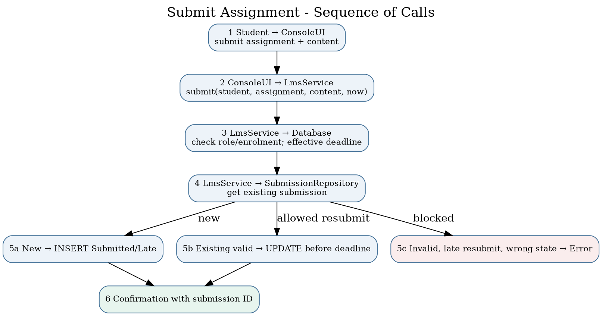{width=95%}

The console receives an assignment ID and submission text. The service checks active Student role and course enrolment and retrieves the effective deadline. If a submission exists, repository `replace` is permitted only when the original remains Submitted and the new timestamp is within the effective deadline. Otherwise a new row is inserted as Submitted or Late. Bound SQL parameters prevent special characters in content from being executed as SQL. Empty content, absent enrolment, invalid assignment and forbidden resubmission produce handled errors and no successful write.

### Sequence — Moderate and release marks

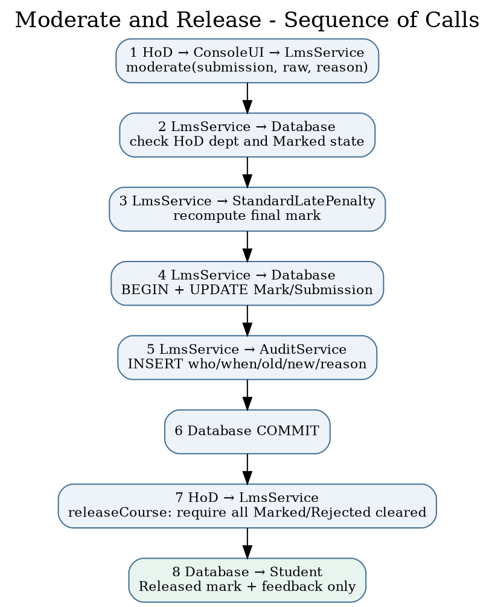{width=70%}

The HoD must belong to the corresponding department and the current submission must be Marked. The service recalculates the final value using the policy, records a reason, inserts an audit event within the transaction, and advances the status to Moderated. A separate HoD release command checks that no Marked or Rejected grade remains for the course, then advances all Moderated records to Released. A Student results query filters by both the student ID and Released status. A rejection transitions the grade to Rejected and requires the lecturer to mark it again before it can be moderated. Audit entries include the actor, timestamp, previous value, new value, and reason.

## 3.4 Database design (5 marks)

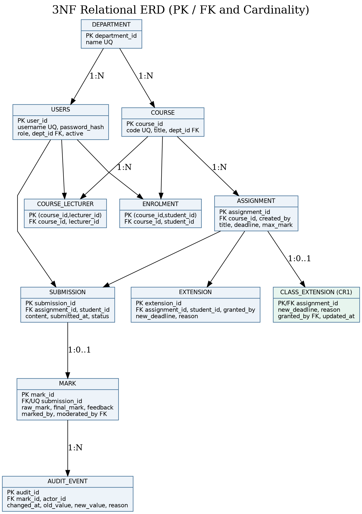{width=70%}

The **v1.0 baseline** tables are `department`, `users`, `course`, `course_lecturer`, `enrolment`, `assignment`, `extension`, `submission`, `mark`, and `audit_event`. The **v1.1 CR1 addition** is `class_extension`. A normalised structure keeps users/departments/courses separate and uses junction tables for many-to-many associations. `submission` has `UNIQUE (assignment_id, student_id)` to enforce the chosen overwrite-resubmission requirement. `mark.submission_id` is unique to give a maximum of one current mark per submission. `audit_event` is append-only in application operations to preserve historical mark changes; it intentionally duplicates historical values because an audit log stores event history, not a current relational fact. `class_extension` is assigned primary key `assignment_id`, making class-wide deadlines one current override per assignment.

### Data dictionary

| Table | Primary key / key fields | Important attributes, domain and constraints |
|:--|:--|:--|
| `department` | `department_id` INTEGER PK | `name` TEXT, non-empty, unique |
| `users` | `user_id` INTEGER PK; `dept_id` FK nullable | `username` TEXT unique case-insensitive, `password_hash` TEXT, `role` enum CHECK, `active` 0/1 |
| `course` | `course_id` PK; `dept_id` FK | `code` TEXT unique, `title` TEXT |
| `course_lecturer` | (`course_id`, `lecturer_id`) composite PK/FKs | Assignment of one or more lecturers per course |
| `enrolment` | (`course_id`, `student_id`) composite PK/FKs | Enrolment, prevents duplicates |
| `assignment` | `assignment_id` PK; `course_id`, `created_by` FKs | `title` TEXT; `deadline` INTEGER UTC epoch; `max_mark` REAL positive |
| `extension` | `extension_id` PK; assignment/student/lecturer FKs | `new_deadline` INTEGER epoch; `reason` TEXT; UNIQUE assignment/student |
| `submission` | `submission_id` PK; assignment/student FKs | `content` TEXT, `submitted_at` UTC epoch, `status` enum; UNIQUE assignment/student |
| `mark` | `mark_id` PK; `submission_id` FK UNIQUE | `raw_mark`, `final_mark` REAL nonnegative; `feedback` TEXT; marking/moderation user FKs |
| `audit_event` | `audit_id` PK; `mark_id`, `actor_id` FKs | `changed_at` INTEGER epoch; `old_value` nullable, `new_value` REAL, `reason` TEXT non-empty |
| `class_extension` *(v1.1)* | `assignment_id` PK/FK | `new_deadline` INTEGER, `reason` TEXT, `granted_by` FK, `updated_at` INTEGER |

### Normalisation to 3NF

Every row has a primary key. First Normal Form holds because columns contain atomic data and junction tables represent multi-valued relationships. Second Normal Form holds because the only composite-key tables (`enrolment` and `course_lecturer`) have no dependent non-key attributes, eliminating partial-key dependencies. Third Normal Form holds because `course` stores `dept_id` rather than duplicating the department name; `mark` stores its foreign key to `submission` rather than duplicating its student and assignment identity; `users` stores a department foreign key rather than a textual department name; and assignment-specific extensions are separately keyed. No non-key descriptive attribute depends transitively upon another non-key descriptive attribute inside the same table. Stored `final_mark` is a deliberate derived snapshot required for released results, and `audit_event` stores immutable historical before/after facts; both are explicit denormalisation-for-history/performance trade-offs that do not create the usual editable transitive dependencies.

### SQL schema and class-to-table mapping

The executable creates its SQLite schema using `Database::schema()`; the reviewed SQL deployment reference is **`config/schema.sql`**. Both create the same core tables and constraints, with the file carrying an additional optional role index. All inserts/updates/deletes use `Statement::bind()` on parameterised queries; table-name diagnostics use a fixed allowlist. `Database` maps to the connection, `Statement` to prepared commands, `User`/subtypes to `users.role`, `SubmissionView`/`SubmissionRepository` to `submission`, `ReviewRow` to the authorised join across `submission`, `assignment`, `mark` and course membership; `AssignmentView` to `assignment` plus `extension`/`class_extension`, `MarkView` to released `mark` joined to `submission`, `AuditService` to `audit_event`, and `LmsService` orchestrates `department`, `course`, `course_lecturer`, `enrolment`, `assignment`, `extension`, `class_extension`, `submission`, and `mark`. Inheritance is mapped using **single-table inheritance** with a role discriminator because all roles share username/password/account properties; this avoids redundant sub-tables. Audit events use a separate historical table even though there is no independently mutable `AuditEvent` aggregate.

**Assumptions and important constraints:** all dates are parsed as UTC `YYYY-MM-DD HH:MM:SS`; operators must choose the corresponding UTC time. SQLite foreign keys are enabled at connection startup; indexes target frequent lookups. The current schema validates role strings and relationships but does not express cross-table checks such as “only a user with role Lecturer can be entered into course_lecturer” using SQL triggers; the business service enforces those role constraints. The console host must be secured against external modification of the database file.

## 3.5 CR1 design delta for v1.1

The Phase 8 change request is **perfective maintenance**: a new class-wide deadline control adds useful behaviour without fixing a known bug. The new `class_extension` table stores one override per assignment. `LmsService::classExtension()` checks role, course assignment, non-empty reason and new deadline greater than the original. `LmsService::userDeadline()` chooses the **latest** of original, class and individual deadlines for that student. `AssignmentView` shows both original and effective dates and the source string `original`, `class`, or `individual`. This prevents a class-wide extension from reducing a more generous individual extension. Diagrams, SQL schema and regression cases in this package show the updated design. To reproduce a strict v1.0 design in a report, omit the `class_extension` table and the `classExtension()` and `class` decision branches.

## 3.6 Traceability and acknowledged limitations

The completed diagram files are provided as editable `.puml` sources and PNG previews under `diagrams/`. Coverage of every Must requirement is documented in `docs/traceability.csv`, with design, implementation and test links. Known limitations: the executable is a single-host console application; full 50-client network concurrency has not been demonstrated; the notification observer stores in-memory events only; no file attachments are implemented, so submission content is text; there is no real school acceptance sign-off. These limitations do not silently change the stated SRS, but must be resolved or explicitly accepted before production deployment.

# 5. Phases 4–8 and Professional Issues

**Project:** CS4433 Moderated LMS | **Student:** Chefa T. J., 202100088 | **Architecture:** console, C++17, SQLite, single host | **Implemented version:** 1.1 (incorporates v1.0 and CR1)

## 5.1 Phase 4 — Implementation (21 marks)

### Implementation overview and package structure

The deliverable contains real C++17 source in `src/lms.cpp` and `src/main.cpp`, the public interfaces in `include/lms/lms.hpp`, the SQL schema in `config/schema.sql`, tests in `tests/`, and a `CMakeLists.txt`. `README.md` is the build guide. The console has a login loop, role-specific command menus, typed ID/date/numeric input, handled exceptions and password masking in interactive terminals. It does not rely on a web server or internet connection. The database is created automatically if the specified file does not exist; administrative bootstrap is allowed only when there are no users, reducing accidental recreation of default privileged accounts.

**Administrator functions:** create/update/deactivate users, manage departments and courses, assign lecturers and enrol students. **Lecturer functions:** list assigned submissions with their IDs/content, create assignments, grant individual extensions, grant class extensions (v1.1), and record marks plus required written feedback. **HoD functions:** list departmental submissions and recorded marks, review/adjust moderated marks, reject for re-marking and release approved marks. **Student functions:** list enrolled assignments and effective deadlines, submit/resubmit text, and view only released grades and feedback. Authorization is checked in the service, not just the menu. An inactive account cannot authenticate. A HoD can moderate only courses matching their department; lecturers can mark only courses assigned to them.

### Detailed business-rule realization

All grade operations compute an effective deadline by retrieving the assignment's original deadline, then applying any assignment-specific class extension and any student-specific extension, choosing the latest date. On-time work is accepted as Submitted. Work after the effective deadline is accepted as Late, including work beyond three days late, but the late-penalty strategy returns zero for a delay greater than 72 hours. Late days are calculated as `ceil(secondsLate / 86400)`, with an immediate first-day penalty for a positive delay; exactly 24, 48 and 72 hours retain penalties of 10%, 20% and 30%, respectively. Deduction is a fraction of the assignment maximum. Mark values are validated between zero and the maximum; negative and nonfinite inputs are rejected. The stored raw mark and final mark are distinct, supporting transparent moderation.

The system records a single active submission per (assignment, student). Before the effective deadline, an already Submitted record can be replaced; a new copy does not generate a second row. A record already Late or in a grading/moderation state cannot be overwritten. This matches Phase 2's explicit “resubmission overwrites previous submission” interpretation. Rejected means HoD rejection of marking and enables the lecturer to record a new mark, after which the HoD must moderate again. The HoD cannot release a course while any recorded mark remains Marked or Rejected; students only retrieve grades from a row whose submission status is Released. A change to a final mark is atomically paired with an audit event containing the actor, timestamp, old value (NULL for first marking), new value and reason.

### Persistence and secure design

All persistent tables are created in SQLite. The RAII wrapper frees prepared statements; a connection is closed when its owner is destroyed. All user-supplied values use parameter binding rather than string concatenation. SQLite foreign keys, uniqueness constraints, status/role CHECK constraints, appropriate lookup indexes, a busy timeout and WAL journal mode improve correctness and file-level concurrency tolerance. The WAL mode does not convert this console into an authorised multi-user LAN service. Transactions wrap marking, moderation and rejection so grade changes and audit events commit together; future improvements should also wrap release prechecks and mutation in a single transaction for stronger concurrency guarantees.

Passwords are **never stored in plaintext**. OpenSSL's `PKCS5_PBKDF2_HMAC` derives 32 bytes using SHA-256, a fresh 16-byte random salt and 310,000 iterations. Stored format includes algorithm, iteration count, salt and derived hash. `CRYPTO_memcmp` is used for comparison. The salt makes identical passwords normally produce different stored hashes; iteration work raises offline guessing costs. PBKDF2 is a recognised cryptographic primitive and is available in OpenSSL, although Argon2id is preferable when a supported dependency is available. Password length is at least ten characters in this prototype; production policy should add breached-password screening, credential rotation/administration and restricted database backup handling. The system contains no hard-coded default password.

The application catches `std::exception` at command level, presents errors without unwinding the interactive loop and validates numeric/date input. Input errors do not turn into SQL because the database interface binds values. DB file permissions, disk encryption, local OS login security, secure backups and physical school access remain deployment responsibilities. The UI also accepts user-entered UTC timestamps for assignment deadlines and submission demonstrations; production assessment submissions should derive timestamps from a trusted host/server-side clock rather than accepting a caller-supplied API timestamp to prevent backdating. This is an explicitly documented security limitation.

### Coding standard, building and fidelity to Phase 3

Code is C++17 with value types, `std::unique_ptr`, RAII, const-correct methods, exceptions and fixed SQL parameter positions. Follow the C++ Core Guidelines' resource-lifetime conventions; names use PascalCase classes and camelCase functions, and SQL identifiers use snake_case. Domain rules stay outside the UI and tests call the service methods directly. Build on Linux with `cmake -S . -B build -DCMAKE_BUILD_TYPE=Debug`, `cmake --build build`, and `ctest --test-dir build --output-on-failure`. For Windows use a C++17 compiler with CMake, OpenSSL and SQLite development libraries (MSYS2 or Visual Studio plus vcpkg). See `README.md` for exact commands.

An abstraction shortfall is worth noting rather than concealing: the dedicated `SubmissionRepository` is implemented, while other domain-table queries are still written in `LmsService` through the `Statement` abstraction. Thus the intended layered design is followed at the SQL-interface level but full repository-per-aggregate separation is not complete. The console itself contains no SQL; the scope can be refactored without changing the UI. UserFactory, Strategy, Observer and Repository are all present and executable.

## 5.2 Phase 5 — Verification and validation (12 marks)

### Strategy, V-Model mapping and criteria

The verification plan relates each test level to the artifact that specifies expected behaviour. **Unit tests** verify individual policy classes against boundary/equivalence partitions and validate date parsing. Entry: implemented business rules compile. Exit: all defined policy tests pass. **Integration tests** verify the service, SQLite, authentication, role and audit interactions against class/database design. Entry: schema and service methods implemented. Exit: all integration tests pass and each state transition is repeatable. **System tests** derive complete workflows from the three fully dressed Phase 2 use cases, including exception paths; they exercise persistent state and role separation. Entry: runnable console and test database. Exit: pass all specified flows and log any defects. **Acceptance tests** target school stakeholder decisions on HoD control, deadline fairness, usability and offline access. Entry: technician-installed build and representative test accounts. Exit: principal, HoD and IT representative approve. Stakeholder sign-off has **not** been obtained; the console prototype is not production accepted.

Equivalence classes for late submission are: on-time (`t <= deadline`), first day `(0, 86400]` late, second day `(86400, 172800]`, third day `(172800, 259200]`, and beyond three days `(259200, infinity)`. Boundary values are -1, 0, +1, 86400, 86401, 172800, 172801, 259200 and 259201 seconds relative to effective deadline. At maximum 100 and raw mark 84, values are 84, 84, 74, 74, 64, 64, 54, 54, 0, respectively. Invalid marks (-2, maximum+1, nonfinite) must throw. Security partitions include correct/incorrect passwords, active/inactive users, assigned/unassigned lecturers, same/other-department HoDs, and student attempts to retrieve an unreleased result.

### Automated tests and measured results

`tests/test_core.cpp` is a dependency-light CTest driver with **15 named test groups**. It exercises the UTC parser, penalty boundaries, password hashing, polymorphic roles, administrator CRUD and access constraints, resubmission, late zero, individual and class extensions, departmental moderation and rejection, batch release, SQL injection-resistant binding, on-disk persistence and the audit trail. `tests/test_catch2.cpp` provides an additional **five Catch2 v3 test cases**: penalty boundaries, password and role security, HoD gate and audit, CR1 extension precedence, and restricted review queues. `CMakeLists.txt` discovers Catch2 v3 when installed or fetches it in networked CI when `LMS_FETCH_CATCH2=ON`. In this local environment Catch2 was not installed or fetched, so only the 14 built-in groups were actually executed; the five Catch2 cases should not be reported as passed locally.

On the reference local build, CTest reports one executable test target, `lms_core_tests`, **passed**, and that executable reports **15/15 groups passed, 0 failed**. See `evidence/ctest-local.txt` and `evidence/ctest-coverage.txt`; real logs are included rather than invented screenshots. GCC `gcov -n` showed **96.86% of 637 instrumented executable lines in `src/lms.cpp`**. This is a *line coverage* statistic over 637 instrumented executable physical lines and **does not imply 100% branch/decision coverage**. Before final assessment, run `gcovr` with branch reporting, improve formatting, and reproduce coverage in GitHub Actions. The aspirational requirement of at least 70% business-logic line coverage is met in this *local instrumented run*, with the denominator caveat explicitly disclosed.

### System/acceptance scenarios and exception flows

| Test case | Scenario and expected result | Current evidence |
|---|---|---|
| ST-01 | Student logged in, enrolled; valid first submission on deadline → Submitted | Automated service integration: PASS |
| ST-02 | Existing Submitted work before effective deadline → same row updated | Automated service integration: PASS |
| ST-03 | Invalid/empty content, wrong role or non-enrolment → handled error, no successful submission | Automated service integration: PASS |
| ST-04 | +1, +1 day and +1 second, +72h and +1 second → respective penalties | Automated policy integration: PASS |
| ST-05 | Lecturer individual extension changes only target student's effective deadline | Automated service integration: PASS |
| ST-06 | HoD different department cannot moderate; Student cannot view pre-release | Automated service integration: PASS |
| ST-07 | HoD rejection → lecturer re-mark → HoD moderation → release | Automated service integration: PASS |
| ST-08 | Unmoderated recorded marks block release of an otherwise moderated course | Automated service integration: PASS |
| ST-09 | CR1 class extension, individual extension precedence and assignment-list visibility | Automated service integration: PASS |
| ST-10 | Cold-start console walkthrough performed by non-IT staff within five minutes | Not run; requires observed stakeholder acceptance |
| ST-11 | 800-user login under 2s; 50 concurrent local sessions under 2s | Not run; cannot assert performance requirement |
| ST-12 | Disconnect internet and complete a full console session | Offline architecture verified by dependency review; formal timed acceptance not run |

**Defect log:** DEF-01 (Medium): an early UTC parser accepted a timestamp string without a complete time component; root cause was permissive C++ parsing. Fix: exact regular-expression format check plus calendar round-trip; regression test rejects `2030-01-01` and invalid February dates; current local retest PASS. DEF-02 (Open/High for school deployment): submission timestamp accepted as a public service argument (the console passes current host time) rather than trusted clock, permitting potential backdating. Root cause: testable time-parameter API, which an untrusted future client must not control. Proposed fix: obtain submission time within the service and add a test-double clock for deterministic tests. Retest: not performed. DEF-03 (Open/Medium): no verified capacity benchmark for 50 simultaneous local sessions; cause: single-host console deployment and absent load test harness. Fix would require an approved network/shared-host architecture and performance test. Retest: not performed. Defect statuses are not presented as invented fixes.

## 5.3 Phase 6 — Configuration management and quality assurance (6 marks)

### Configuration management plan

Use a hosted Git repository with `main` protected for releases; use `feature/<issue>` branches for isolated changes and `fix/<issue>` for corrections. Each branch is proposed for a pull request containing linked requirement IDs, test run, changed files and a design-impact note. Review by the author using a recorded checklist before merge; independent supervisor review is preferable for grade-affecting rules. Use Conventional Commit-style messages, e.g. `feat(lms): add course-scoped class deadlines`, `test(cr1): exercise extension precedence`, and `fix(time): reject malformed UTC strings`. Make signed or annotated tags `v1.0.0` and `v1.1.0` after each appropriate commit. This downloaded folder includes a **local Git repository** with working `v1.0.0` and `v1.1.0` tags; it is **not hosted and no remote CI has run**, so `Repository URL`, GitHub pull-request records and remote execution must be added after user setup.

`.github/workflows/ci.yml` describes the automated Linux job: check out source, install compiler/SQLite/OpenSSL and tools, configure a coverage build and Catch2 v3, compile, run CTest, calculate coverage via `gcovr`, run cppcheck, and upload the coverage XML. It triggers for pushes and pull requests. This is a prepared **configuration file**, not proof that a GitHub runner has executed it. A networked CI runner may resolve Catch2 through FetchContent, whereas the offline local test run skips it. A missing coverage percentage from hosted Actions should not be filled in by estimation.

### Static analysis, code metrics and review record

A local invocation of `clang++ --analyze -std=c++17 -Iinclude src/lms.cpp` produced no emitted diagnostic lines (stored in `evidence/clang-analyzer.txt`). This is evidence only for the inspected translation unit and the default clang static analyzer checks. The CI configuration also invokes `cppcheck`, but `cppcheck` was **not available in the local environment**; do not claim zero cppcheck findings. Physical code-line counts are recorded in `evidence/source-metrics.txt`; the current file lengths are 834 lines (`src/lms.cpp`), 328 (`src/main.cpp`), 260 (public header), and 412 test-source lines. Physical lines are a reproducible but imperfect size metric; branch and path coverage still need separate evaluation. The repeatable lexical decision-count script `scripts/metrics.py` reports approximate values for important functions: `submit` 8, `mark` 10, `moderate` 3, `userDeadline` 6 and `releaseCourse` 3 (details in `evidence/complexity-estimate.txt`). These are **approximate syntactic counts, not formally calculated CFG cyclomatic complexity**; a lizard/clang-tidy report remains a useful independent check. High-risk functions to scrutinize are `LmsService::submit`, `mark`, `moderate`, `userDeadline`, and command dispatcher in `main.cpp`.

**Self-review checklist and outcome:** [PASS] SQL queries bind untrusted values; [PASS] account/role checks occur inside service; [PASS] foreign keys enabled; [PASS] no plaintext password storage; [PASS] no default password; [PASS] nonempty reason on moderation; [PASS] audit records persisted with grade mutation; [PASS] exception catching at console entry; [OPEN] time source can be supplied by operator; [OPEN] full repository separation for all aggregates; [OPEN] explicit versioned data migration for existing databases; [OPEN] real 50-concurrent-session benchmark and formal usability trial. Verified improvement: strict date format validation with regression coverage. No second-person PR review or external certification is claimed.

## 5.4 Phase 7 — Deployment (4 marks)

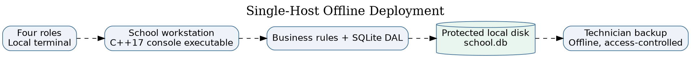

### Installation guide for a school technician

1. Choose one supported local school computer (offline operation is supported). Install a modern C++17 build toolchain, CMake 3.16 or newer, SQLite3 development libraries and OpenSSL development libraries. For Ubuntu/Debian: `sudo apt-get install build-essential cmake libsqlite3-dev libssl-dev`; this is a one-time installation step when package sources are available. On Windows, use Visual Studio Build Tools/vcpkg or MSYS2 packages for the dependencies.
2. Unzip the project into a protected school directory. On a developer machine run `cmake -S . -B build -DCMAKE_BUILD_TYPE=Release` followed by `cmake --build build`. On Linux the executable is typically `build/lms`; on Windows the executable may be under `build/Release/lms.exe` depending on generator.
3. Run the automated smoke test: `ctest --test-dir build --output-on-failure`. Do not deploy if it fails. The tests use isolated/in-memory and temporary data, not the production database.
4. Create a restricted directory for the production `school.db`, writable only by authorised school operators and the designated backup account. Restrict read access because marks and personally identifying information are held in SQLite.
5. On first setup, run `./build/lms /protected/path/school.db --init-admin` and enter a private administrator username and strong password. The program creates the initial account only when the users table is empty. **Do not document or share this secret.**
6. Launch normally with `./build/lms /protected/path/school.db`. Log in as the administrator, create departments and accounts, create courses, assign lecturers and enrol students. Provide unique accounts to the HoDs, lecturers and students.
7. Verify a non-production course/assignment and perform a test of submission, moderation and release, checking that students cannot see marks before release. Record technician sign-off.
8. Plan backup and restoration. Prefer a SQLite online backup process, or stop the application before copying a database. Keep an encrypted offline copy and test restoration quarterly. If WAL mode is active, **do not copy only the `.db` file while the application is running**, since transactions can be in `.db-wal`. Revoke access when staff leave.
9. Store the system and database on the same computer. **Do not share `school.db` over an SMB/NFS network mount** for simultaneous access; if LAN clients are required, engineer an authenticated application server as a separately approved future project.

### Administrator manual

Log in with your assigned username and password; `help` displays commands. Use `add-dept` before adding departmental courses. Use `add-user` to create Lecturer/HoD/Student accounts and assign HoD departments. Use `add-course`, `assign-lecturer` and `enrol` to establish course participation. Use `edit-user` or `deactivate-user` instead of sharing accounts. Maintain an offline backup and never hand the administrator password to a student. `logout` returns to login and `exit` closes the program at the login prompt.

### Lecturer manual

Log in and view the Lecturer menu. Create an assignment via `add-assignment`, entering the assigned course ID, description, UTC deadline and maximum mark. Grant an individual extension using `extend-student` with an extended UTC deadline and reason. In v1.1, `extend-class` sets a class-wide deadline for that assignment; students with a later individual extension keep it. Students should be informed of which UTC instant is intended. After submissions arrive, use `submissions` to see assigned submission IDs/work and then `mark` with the submission ID, raw score and written feedback. A rejected mark can be re-entered and returned for HoD review. You cannot directly release a grade to students.

### HoD manual

Log in and use `review` to inspect submissions in your department; then use `moderate` with the submission ID, revised raw score, and a reason (including “checked; no adjustment” when appropriate). Only departmental courses are visible to your authorisation check. If the rubric needs correction, use `reject` with an explanation, allowing the lecturer to re-mark. Once **all recorded course marks** have been moderated, use `release` for the course ID. This action exposes approved marks and written feedback to students and should not be performed until the school agrees the batch is ready. A release attempt is refused if any recorded mark remains Marked or Rejected.

### Student manual

Log in using the unique student account. Choose `assignments` to see enrolled course assignments, original deadline, effective deadline and extension source. Use `submit`, entering the assignment ID and non-empty text. Submitting again before the effective deadline replaces a prior on-time submission. An initial late submission is recorded but penalised: 10%, 20% or 30% of maximum for days 1–3; work more than 72 hours late receives zero. `results` shows final marks and feedback **only after** the HoD releases them. If the grade is absent, it may still be under review; contact the lecturer or HoD through the school's normal channels.

### Version 1.0 release notes

**Version 1.0.0 — baseline specification:** local authentication and four roles, administrator account/course/enrolment management, assignment creation, individual extension, text submission/resubmission, late penalty, lecturer marking/feedback, HoD moderation/rejection and controlled release, mark-change audit logging, local SQLite persistence. The bundled local Git repository includes a buildable and testable baseline commit tagged `v1.0.0` (14 local test groups passed). The current code is a subsequent commit tagged `v1.1.0` (15 test groups passed). Neither tag has been pushed to a public remote. Not included: web/mobile UI, plagiarism detection, media attachment upload, automated grading or network server. Known risks: local host permissions, a service API parameter for submission timestamps (the console correctly passes the current host clock), no 50-client benchmark.

## 5.5 Phase 8 — Maintenance (6 marks): Change Request CR1

### Classification, objective and impact (2 marks)

CR1 states: “A lecturer should be able to extend the deadline for a whole class, not just an individual student, and extensions should be shown on the student's assignment list.” This is **perfective maintenance** because it extends requested school functionality rather than repairing a fault, adapting to an external law or preventing a foreseen failure. The approved behaviour is that the class-wide override is greater than the original deadline, applies to all students enrolled in the course, and cannot shorten an individually granted later deadline. The effective deadline is `max(original, class, individual)` for a given student. The student assignment list exposes that effective deadline and labels its source. All dates use UTC.

**Requirements affected:** original Phase 2 FR for individual extension, student assignment listing, late penalty and resubmission timing; add `FR-18` class-wide extension (Must) and `FR-19` deadline-source visibility (Must). **Models:** class diagram `LmsService::classExtension` and `AssignmentView`, submission sequence effective-deadline selection, activity/state guards and ERD `class_extension` addition. **Classes/files:** `LmsService::classExtension`, `LmsService::userDeadline`, `LmsService::studentAssignments` in `src/lms.cpp`; `AssignmentView`/`LmsService` declarations in `include/lms/lms.hpp`; `src/main.cpp` adds `extend-class`. **Tables:** add `class_extension(assignment_id PK/FK,new_deadline,reason,granted_by,updated_at)`; existing `assignment` and `extension` remain unchanged. **Tests:** boundary and precedence tests for class extension, individual exception and visible list, plus rerun of original submission/marking/moderation suite.

### Implementation and regression (4 marks)

The code contains `LmsService::classExtension` and the `extend-class` command; the class_extension table is created in both schema definitions. `userDeadline` uses the greatest permitted deadline and reports its source. The admin/lecturer roles do not inherit new permissions: only a lecturer assigned to the relevant course may change the class deadline. `tests/test_core.cpp` contains `CR1 class extension, overlapping overrides, student list`, and `tests/test_catch2.cpp` contains a Catch2 CR1 case. The locally run built-in suite passes all **15/15** test groups, including legacy authentication, submission, audit and moderation tests. The Catch2 CR1 case is present but not locally executed without Catch2 v3. Separate local `v1.0.0` and `v1.1.0` tags now exist in the supplied Git history; publishing the repository and obtaining a hosted CI run remain the student’s external actions.

**Database migration note:** the current `CREATE TABLE IF NOT EXISTS` schema safely adds an empty `class_extension` table when a v1.0 database is opened by the v1.1 executable. Future migrations should use `PRAGMA user_version` with explicit backup and rollback procedures; this is not an irreversible destructive migration. If an administrator rolls back to v1.0 executable, the v1.0 code will not understand class-wide extension deadlines, so rollback must include restoring the earlier backup and communicating the impact to users.

## 5.6 Professional, legal and ethical issues (3 marks)

### Privacy and data protection

The school handles student usernames, enrolments, submissions, assessment scores and feedback—personal information, including data of children. Lesotho's **Data Protection Act, 2012 (Act 5 of 2012; legislation text gives the short title “Data Protection Act, 2011”)** is the primary local legal reference. The student’s original Phase 1 mentions South Africa's POPI Act; POPIA may be relevant if personal information is processed subject to South African law, but it should not be automatically treated as the governing law for an entirely Lesotho-based school. The design minimises collection (no unnecessary addresses or identity numbers), uses active/inactive accounts, role-restricted reads and no cloud transfer, and retains traceable audit events. School management still needs a privacy notice, data retention policy, lawful processing basis, access/correction procedure and incident-response plan. The database and offline backups must be protected physically and by OS file permissions. Reference: https://lesotholii.org/akn/ls/act/2012/5/eng%402012-02-22.

### Assessment confidentiality and professional integrity

Grade changes must be accountable: the audit log records who made each change, time, previous/final numeric value and a reason. HoD sign-off prevents premature student disclosure, while lecturer feedback and controlled re-marking support explainability. Privileged school users should never share credentials, alter database files directly or change scores outside the approved audit path. Auditing is an ethical control as well as an administrative one. However, the local host remains trusted: a person with OS-level database write access could bypass application logging. School policy must control physical access, backups, privileges and the right to inspect audit logs.

### Accessibility, equality and fairness

The text console may work with keyboard navigation and some assistive technologies, but accessibility has not been audited with actual screen-reader users. Short commands, clear prompts, meaningful errors and a written role manual help users with limited IT literacy; future verification should include high-contrast terminal profiles, screen-reader tests and alternative formats for assessment content. The fixed 10%-per-day maximum-based deduction is predictable but can disadvantage students with disability, illness, transport or connectivity difficulties. Individual extensions, class-wide relief after closures and explicit reasons provide procedural safeguards. A school's governing policy should specify who can approve exceptions, and students need a review/appeal path. The student should be told the exact UTC due time and the consequences of late submission in advance.

### Ethical limits and responsible deployment

The student software engineer has a responsibility to disclose unmeasured SRS targets, not claim school acceptance without stakeholder participation and not misrepresent local CI as hosted execution. In particular, 800-user login performance and 50 concurrent-session latency remain unverified, and a trusted timestamp generated inside the business service is an open production hardening item. The current prototype is suitable for demonstration and incremental assessment, but real use with minors' records requires an institutional risk assessment, access controls and teacher training before deployment.

## Selected references

- National University of Lesotho, *CS4433 Software Engineering Individual Assignment*, 7 November 2026 (assignment brief supplied with this project).
- Chefa, T. J., *Project Management Plan (Phase 1)*, supplied work, 2026.
- Chefa, T. J., *Requirements Engineering (Phase 2)*, supplied work, 2026.
- Chefa, T. J., *Software Design Document (Phase 3)*, supplied work, 2026.
- Lesotho, *Data Protection Act, 2012*, Act 5 of 2012, https://lesotholii.org/akn/ls/act/2012/5/eng%402012-02-22.
- OpenSSL Project, `PKCS5_PBKDF2_HMAC`, https://docs.openssl.org/master/man3/PKCS5_PBKDF2_HMAC/.
- Catch2, *CMake integration*, https://github.com/catchorg/Catch2/blob/devel/docs/cmake-integration.md.
- SQLite, *Foreign Key Support*, https://www.sqlite.org/foreignkeys.html; *Write-Ahead Logging*, https://sqlite.org/wal.html.

# Conclusion

The project demonstrates a coherent moderated assessment lifecycle rather than treating marks as immediately public values. The user's original Waterfall planning, conflict resolutions and layered console decision remain the foundation. The completed Phase 3 diagrams clarify responsibilities and data relationships, and the source implements C++17 polymorphic user roles, grade penalties and extensions, mark moderation, audit and SQLite persistence. Phase 8's class-wide extension is integrated into the same effective-deadline computation used by student lists, submissions and penalties, avoiding inconsistent policy paths. Testable code and prepared CI files help show how design artifacts map to evidence.

The local run provides 15 passing test groups and instrumented business-source line coverage above the stated 70% target, with qualifications about line coverage versus branch coverage and unavailable Catch2 execution. The release documentation, class-extension regression and updated risk assessment complete the intended academic workflow in prototype form. The greatest outstanding risks are operational rather than algorithmic: trusted submission time, restricted local database access, real offline usability and capacity testing, hosted Git/CI evidence, and independent acceptance by school stakeholders. These gaps must be resolved or formally accepted before an actual school relies on this prototype for minors' assessment records.

# Appendices

## Appendix A — Traceability matrix

The complete functional and non-functional matrix, including Must/Should priorities, use cases, design operations, tables, source paths, test IDs and honest pass/remaining-work status, is supplied separately as `docs/traceability.csv`. It contains FR-01 through FR-19 (including CR1), and NFR-01 through NFR-08. This CSV can be opened and filtered using a spreadsheet tool without retyping a wide table from the report.

## Appendix B — Complete executable design and SQL

UML sources and PNG previews are in `diagrams/`: component, class, submission state machine, swimlane activity, Submit sequence, HoD Moderate/Release sequence, ERD and deployment diagram. The original WBS, Gantt and use case image are also provided, with the original DOCX source documents in `original_phases/`. The SQLite `CREATE TABLE` definitions and indexes are in `config/schema.sql`, and the actual executable schema is in `Database::schema()` in `src/lms.cpp`.

## Appendix C — Testing, evidence and outstanding acceptance

The CTest-based group suite is `tests/test_core.cpp`; the optional Catch2 v3 suite is `tests/test_catch2.cpp`. The local CTest logs and analyser/coverage measurements are in `evidence/`. The complete test-case and defect summary is given in the Phase 5 section of this report. No hosted CI screenshot, teacher sign-off, 50-session benchmark or public repository link is asserted. To produce them, push this project to a controlled Git repository, run the GitHub Actions workflow and record observed school trial results, including time measurements.

## Appendix D — Updated risk register

| Risk | Original exposure | Phase-gate update | Residual risk / action |
|:--|--:|:--|:--|
| R1 scope creep | 16 | Change managed via CR1 | Medium; lock v1.1 scope |
| R2 moderation complexity | 12 | State machine/tests implemented | Medium; test school exceptions |
| R3 800-user SQLite performance | 8 | Indexed SQL design | High until actual benchmark |
| R4 password storage | 15 | Salted OpenSSL PBKDF2 | Medium; host access and password policy |
| R5 developer unavailability | 15 | Source/docs/tests packaged | Medium; store in Git remote |
| R6 penalty/extension interpretation | 12 | Boundary/precedence tests | Low for tested values |
| R7 untrusted caller-controlled submission clock | New, high | Documented; no server clock yet | High; change API to trusted timestamp |
| R8 50-concurrent-session requirement | New, high | Architecture mismatch disclosed | High; establish capacity architecture |
| R9 database access beyond application | New, high | Host restrictions prescribed | High until secure deployment |

## Appendix E — Release checklist

- [x] C++17 executable built locally.
- [x] SQLite schema and four-role access restrictions implemented.
- [x] Phase 3 component, class, behavioural, ERD and SQL design files supplied.
- [x] CR1 v1.1 class-wide deadline implemented and regression tests added.
- [x] Local built-in automated tests passed (15/15 groups).
- [x] Local Clang static-analyser invocation completed with no emitted diagnostics.
- [x] Local physical-line gcov measurement recorded with limitations disclosed.
- [ ] Catch2 v3 tests executed in a connected runner.
- [x] Local Git commits and annotated v1.0.0/v1.1.0 tags exist.
- [ ] Repository pushed to a host and independent PR review recorded.
- [ ] 800-user and 50-concurrent-session benchmarks completed.
- [ ] Actual school acceptance and accessibility walkthrough completed.
- [ ] Production-grade trusted submission timestamp and database-access hardening completed.
