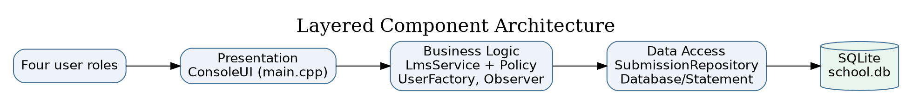
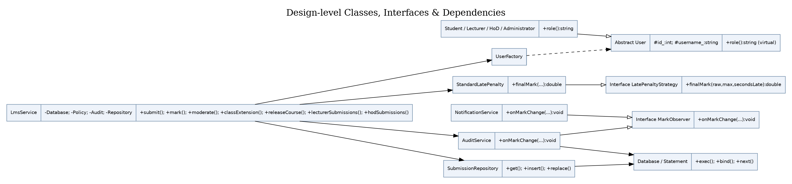
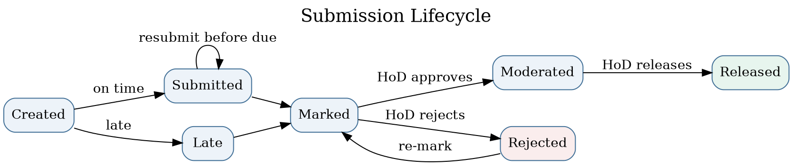
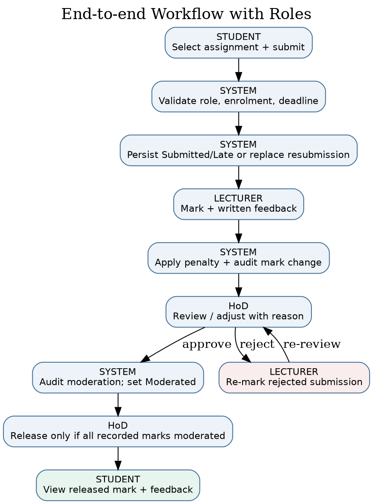
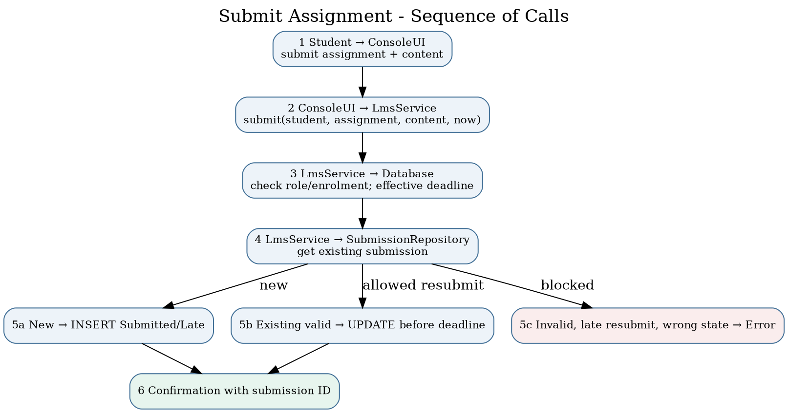
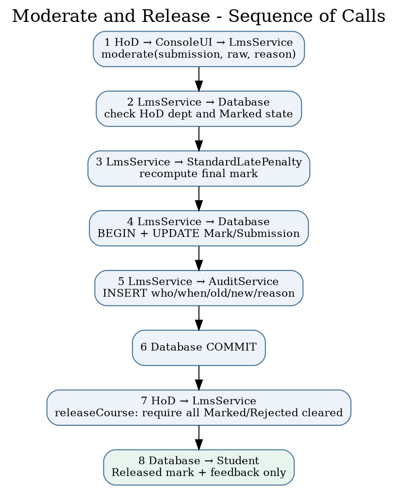
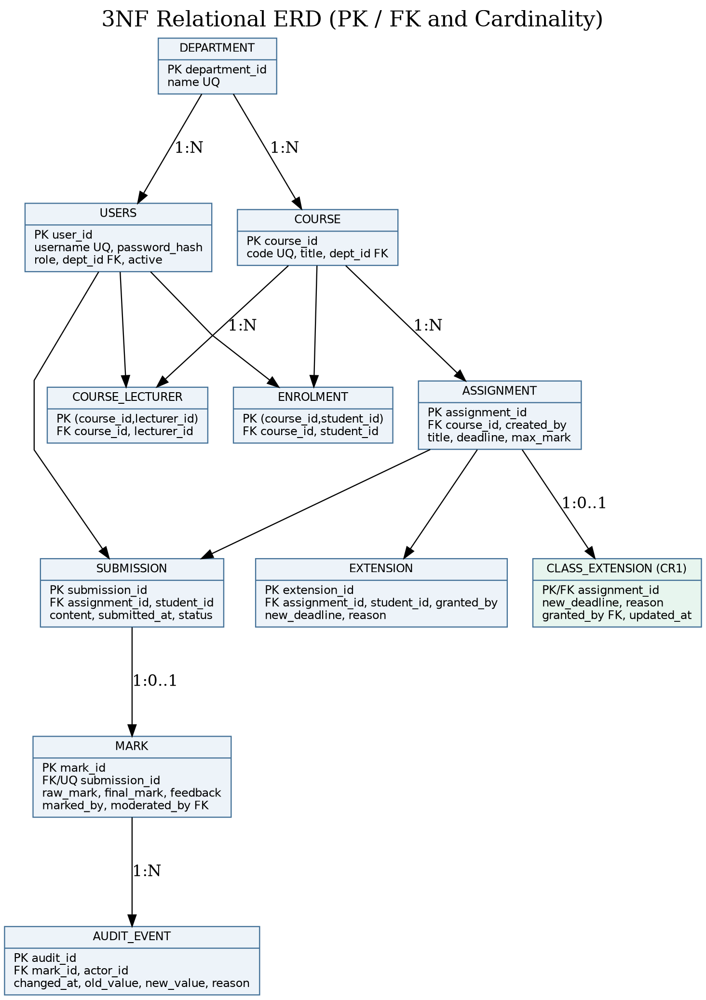

# Phase 3 — Completed Software Design Document

**Project:** Moderated Learning Management System (LMS) | **Student:** Chefa T. J. (202100088)  
**Baseline:** Submitted Phase 1, Phase 2 and Phase 3. **Implementation design:** console application, C++17, SQLite, four-layer architecture. **Design status:** detailed v1.0 baseline with v1.1 extension shown separately.

## 3.1 Architecture and justification (5 marks)

The system uses the **layered architectural style** selected in the student's original Phase 3 document. Layers depend only on the next lower layer: presentation (`src/main.cpp`), business services/domain rules (`LmsService`, polymorphic `User` and derived types, penalty policy and observers), persistence abstraction (`Database`, `Statement`, `SubmissionRepository`) and SQLite file storage (`school.db`). The console requests service operations; it does not construct SQL statements. Policy and access rules are enforced again in the service, so a forged UI request cannot bypass authorization.

{width=95%}

**Why layered:** limited infrastructure on an offline school computer; explicit boundaries keep the CLI replaceable and make business rules testable. **Rejected alternative:** Model–View–Controller was considered but its additional view/controller separation would be disproportionate for a linear console program with no parallel graphical views. A client/server architecture was also not adopted because it would introduce a server, network authentication and additional operational costs that the case study does not require. The proposed executable is a **single-host application**, not a 50-remote-client LAN server; the SRS's 50 concurrent sessions target remains unverified without an additional deployment architecture.

**Dependency rule:** `main.cpp → LmsService → repository/SQL abstraction → SQLite`. `StandardLatePenalty` and `UserFactory` are business components; the `AuditService` observer uses the database abstraction for transactional audit events. Read-only diagnostic SQL in the test code does not represent production access from the presentation layer.

## 3.2 Detailed class diagram and design patterns (7 marks)

{width=95%}

`User` is an abstract base class containing protected `id_` and `username_`, and a pure virtual `role()` method. `Student`, `Lecturer`, `HoD`, and `Administrator` derive from it (generalisation, one concrete role per runtime user). `UserFactory::create` returns `unique_ptr<User>` according to the row's role discriminator. **Factory** centralises role-based instantiation; code invoking `role()` relies on polymorphism, not scattered inheritance-specific constructors.

`LatePenaltyStrategy` declares `finalMark(raw, maximum, secondsLate)`; `StandardLatePenalty` implements the policy. For an on-time submission, the final mark is the raw mark. For late work: `days = ceil(late_seconds / 86400)`; if `days` is 1, 2 or 3, deduct `days × 0.10 × maximum` from the raw mark, clamped at 0. Beyond three days, the result is 0. This interpretation deducts 10% of **available maximum**, not 10% of the student's earned raw mark. **Strategy** makes replacement of the school policy possible without rewriting marking.

`MarkObserver` is an interface. `AuditService` and `NotificationService` implement it. The marking service invokes the audit observer within its SQL transaction and invokes the in-memory notification observer after commit; the latter does **not** constitute persistent or student-visible messaging. **Observer** permits logging/notification side effects to be separated from grade calculations. `SubmissionRepository` offers `get`, `insert`, and `replace` over parameterised SQL and separates a coherent persistence workflow from the service. `Database` owns the SQLite connection and `Statement` owns a compiled query, using RAII to release resources. The broader SQL operations are currently encapsulated inside `LmsService` through this data-access wrapper; introducing dedicated repositories for *all* tables would further strengthen strict layering in a larger deployment.

**SOLID mapping:** Single Responsibility: SQL lifetime (`Database`/`Statement`), penalties (`StandardLatePenalty`), and console UI (`main.cpp`) differ. Open/Closed: new policy subclasses can be added behind the strategy interface, although the current concrete member in `LmsService` would need dependency injection to swap at runtime. Liskov Substitution: concrete users implement the same `role()` contract. Interface Segregation: observer and penalty interfaces are focused. Dependency Inversion: the policy contract and observer contracts are abstract; DB connectivity remains a concrete dependency, explicitly a practical compromise for the small offline application.

**Review/read use cases:** `LmsService::lecturerSubmissions` and `LmsService::hodSubmissions` provide role-scoped lists of submission IDs, content, grading state and available feedback so users can identify records before marking or moderation. The HoD query is restricted to their department, and the lecturer query to assigned courses.

**Key associations/multiplicities:** one department owns zero or more courses and may have multiple users; one course has many assignments; students and courses associate many-to-many through `enrolment`, as do lecturers and courses through `course_lecturer`; an assignment has zero or many submissions; each student has at most one active submission per assignment; a submission has zero or one mark; each mark has zero or more audit events; assignment/student pairs have at most one individual extension; from v1.1, each assignment has at most one current class extension. All composite foreign keys are physically enforced through keys and uniqueness rules in the schema.

## 3.3 Behavioural models (7 marks)

### Submission state machine

{width=95%}

`Created` represents a conceptual pre-submission state, **not a persisted status**. Persisted states are `Submitted`, `Late`, `Marked`, `Moderated`, `Released` and `Rejected`. A first submission after the effective deadline is accepted and stored as Late, even if more than three days overdue (its computed final mark is then zero). A submitted record may be replaced only if it was submitted on time and the replacement also occurs before the effective deadline; it cannot be resubmitted after marking. Rejected is a moderation outcome to allow lecturer re-marking, **not** a denial of late submission. A student may read marks only in Released state.

### End-to-end activity diagram with swimlanes

{width=70%}

Swimlanes separate actions by Student, System, Lecturer, and HoD. Submission validation guards the persistence path; the service determines effective deadline, persists or replaces the work and acknowledges receipt. The lecturer records raw marks and feedback. The system calculates any late deduction and saves both mark and audit record. The HoD can approve with a required reason, or reject for re-marking. Release cannot occur while recorded marks in the course are still marked or rejected. This does not claim completion of every missing/unsubmitted assignment: it gates all **recorded marked submissions**.

### Sequence — Submit assignment (late and resubmission branches)

{width=95%}

The console receives an assignment ID and submission text. The service checks active Student role and course enrolment and retrieves the effective deadline. If a submission exists, repository `replace` is permitted only when the original remains Submitted and the new timestamp is within the effective deadline. Otherwise a new row is inserted as Submitted or Late. Bound SQL parameters prevent special characters in content from being executed as SQL. Empty content, absent enrolment, invalid assignment and forbidden resubmission produce handled errors and no successful write.

### Sequence — Moderate and release marks

{width=70%}

The HoD must belong to the corresponding department and the current submission must be Marked. The service recalculates the final value using the policy, records a reason, inserts an audit event within the transaction, and advances the status to Moderated. A separate HoD release command checks that no Marked or Rejected grade remains for the course, then advances all Moderated records to Released. A Student results query filters by both the student ID and Released status. A rejection transitions the grade to Rejected and requires the lecturer to mark it again before it can be moderated. Audit entries include the actor, timestamp, previous value, new value, and reason.

## 3.4 Database design (5 marks)

{width=70%}

The **v1.0 baseline** tables are `department`, `users`, `course`, `course_lecturer`, `enrolment`, `assignment`, `extension`, `submission`, `mark`, and `audit_event`. The **v1.1 CR1 addition** is `class_extension`. A normalised structure keeps users/departments/courses separate and uses junction tables for many-to-many associations. `submission` has `UNIQUE (assignment_id, student_id)` to enforce the chosen overwrite-resubmission requirement. `mark.submission_id` is unique to give a maximum of one current mark per submission. `audit_event` is append-only in application operations to preserve historical mark changes; it intentionally duplicates historical values because an audit log stores event history, not a current relational fact. `class_extension` is assigned primary key `assignment_id`, making class-wide deadlines one current override per assignment.

### Data dictionary

| Table | Primary key / key fields | Important attributes, domain and constraints |
|:--|:--|:--|
| `department` | `department_id` INTEGER PK | `name` TEXT, non-empty, unique |
| `users` | `user_id` INTEGER PK; `dept_id` FK nullable | `username` TEXT unique case-insensitive, `password_hash` TEXT, `role` enum CHECK, `active` 0/1 |
| `course` | `course_id` PK; `dept_id` FK | `code` TEXT unique, `title` TEXT |
| `course_lecturer` | (`course_id`, `lecturer_id`) composite PK/FKs | Assignment of one or more lecturers per course |
| `enrolment` | (`course_id`, `student_id`) composite PK/FKs | Enrolment, prevents duplicates |
| `assignment` | `assignment_id` PK; `course_id`, `created_by` FKs | `title` TEXT; `deadline` INTEGER UTC epoch; `max_mark` REAL positive |
| `extension` | `extension_id` PK; assignment/student/lecturer FKs | `new_deadline` INTEGER epoch; `reason` TEXT; UNIQUE assignment/student |
| `submission` | `submission_id` PK; assignment/student FKs | `content` TEXT, `submitted_at` UTC epoch, `status` enum; UNIQUE assignment/student |
| `mark` | `mark_id` PK; `submission_id` FK UNIQUE | `raw_mark`, `final_mark` REAL nonnegative; `feedback` TEXT; marking/moderation user FKs |
| `audit_event` | `audit_id` PK; `mark_id`, `actor_id` FKs | `changed_at` INTEGER epoch; `old_value` nullable, `new_value` REAL, `reason` TEXT non-empty |
| `class_extension` *(v1.1)* | `assignment_id` PK/FK | `new_deadline` INTEGER, `reason` TEXT, `granted_by` FK, `updated_at` INTEGER |

### Normalisation to 3NF

Every row has a primary key. First Normal Form holds because columns contain atomic data and junction tables represent multi-valued relationships. Second Normal Form holds because the only composite-key tables (`enrolment` and `course_lecturer`) have no dependent non-key attributes, eliminating partial-key dependencies. Third Normal Form holds because `course` stores `dept_id` rather than duplicating the department name; `mark` stores its foreign key to `submission` rather than duplicating its student and assignment identity; `users` stores a department foreign key rather than a textual department name; and assignment-specific extensions are separately keyed. No non-key descriptive attribute depends transitively upon another non-key descriptive attribute inside the same table. Stored `final_mark` is a deliberate derived snapshot required for released results, and `audit_event` stores immutable historical before/after facts; both are explicit denormalisation-for-history/performance trade-offs that do not create the usual editable transitive dependencies.

### SQL schema and class-to-table mapping

The executable creates its SQLite schema using `Database::schema()`; the reviewed SQL deployment reference is **`config/schema.sql`**. Both create the same core tables and constraints, with the file carrying an additional optional role index. All inserts/updates/deletes use `Statement::bind()` on parameterised queries; table-name diagnostics use a fixed allowlist. `Database` maps to the connection, `Statement` to prepared commands, `User`/subtypes to `users.role`, `SubmissionView`/`SubmissionRepository` to `submission`, `ReviewRow` to the authorised join across `submission`, `assignment`, `mark` and course membership; `AssignmentView` to `assignment` plus `extension`/`class_extension`, `MarkView` to released `mark` joined to `submission`, `AuditService` to `audit_event`, and `LmsService` orchestrates `department`, `course`, `course_lecturer`, `enrolment`, `assignment`, `extension`, `class_extension`, `submission`, and `mark`. Inheritance is mapped using **single-table inheritance** with a role discriminator because all roles share username/password/account properties; this avoids redundant sub-tables. Audit events use a separate historical table even though there is no independently mutable `AuditEvent` aggregate.

**Assumptions and important constraints:** all dates are parsed as UTC `YYYY-MM-DD HH:MM:SS`; operators must choose the corresponding UTC time. SQLite foreign keys are enabled at connection startup; indexes target frequent lookups. The current schema validates role strings and relationships but does not express cross-table checks such as “only a user with role Lecturer can be entered into course_lecturer” using SQL triggers; the business service enforces those role constraints. The console host must be secured against external modification of the database file.

## 3.5 CR1 design delta for v1.1

The Phase 8 change request is **perfective maintenance**: a new class-wide deadline control adds useful behaviour without fixing a known bug. The new `class_extension` table stores one override per assignment. `LmsService::classExtension()` checks role, course assignment, non-empty reason and new deadline greater than the original. `LmsService::userDeadline()` chooses the **latest** of original, class and individual deadlines for that student. `AssignmentView` shows both original and effective dates and the source string `original`, `class`, or `individual`. This prevents a class-wide extension from reducing a more generous individual extension. Diagrams, SQL schema and regression cases in this package show the updated design. To reproduce a strict v1.0 design in a report, omit the `class_extension` table and the `classExtension()` and `class` decision branches.

## 3.6 Traceability and acknowledged limitations

The completed diagram files are provided as editable `.puml` sources and PNG previews under `diagrams/`. Coverage of every Must requirement is documented in `docs/traceability.csv`, with design, implementation and test links. Known limitations: the executable is a single-host console application; full 50-client network concurrency has not been demonstrated; the notification observer stores in-memory events only; no file attachments are implemented, so submission content is text; there is no real school acceptance sign-off. These limitations do not silently change the stated SRS, but must be resolved or explicitly accepted before production deployment.
