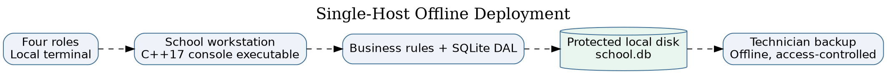

# Phases 4–8 and Professional Issues — Engineering Report

**Project:** CS4433 Moderated LMS | **Student:** Chefa T. J., 202100088 | **Architecture:** console, C++17, SQLite, single host | **Implemented version:** 1.1 (incorporates v1.0 and CR1)

## Phase 4 — Implementation (21 marks)

### Implementation overview and package structure

The deliverable contains real C++17 source in `src/lms.cpp` and `src/main.cpp`, the public interfaces in `include/lms/lms.hpp`, the SQL schema in `config/schema.sql`, tests in `tests/`, and a `CMakeLists.txt`. `README.md` is the build guide. The console has a login loop, role-specific command menus, typed ID/date/numeric input, handled exceptions and password masking in interactive terminals. It does not rely on a web server or internet connection. The database is created automatically if the specified file does not exist; administrative bootstrap is allowed only when there are no users, reducing accidental recreation of default privileged accounts.

**Administrator functions:** create/update/deactivate users, manage departments and courses, assign lecturers and enrol students. **Lecturer functions:** list assigned submissions with their IDs/content, create assignments, grant individual extensions, grant class extensions (v1.1), and record marks plus required written feedback. **HoD functions:** list departmental submissions and recorded marks, review/adjust moderated marks, reject for re-marking and release approved marks. **Student functions:** list enrolled assignments and effective deadlines, submit/resubmit text, and view only released grades and feedback. Authorization is checked in the service, not just the menu. An inactive account cannot authenticate. A HoD can moderate only courses matching their department; lecturers can mark only courses assigned to them.

### Detailed business-rule realization

All grade operations compute an effective deadline by retrieving the assignment's original deadline, then applying any assignment-specific class extension and any student-specific extension, choosing the latest date. On-time work is accepted as Submitted. Work after the effective deadline is accepted as Late, including work beyond three days late, but the late-penalty strategy returns zero for a delay greater than 72 hours. Late days are calculated as `ceil(secondsLate / 86400)`, with an immediate first-day penalty for a positive delay; exactly 24, 48 and 72 hours retain penalties of 10%, 20% and 30%, respectively. Deduction is a fraction of the assignment maximum. Mark values are validated between zero and the maximum; negative and nonfinite inputs are rejected. The stored raw mark and final mark are distinct, supporting transparent moderation.

The system records a single active submission per (assignment, student). Before the effective deadline, an already Submitted record can be replaced; a new copy does not generate a second row. A record already Late or in a grading/moderation state cannot be overwritten. This matches Phase 2's explicit “resubmission overwrites previous submission” interpretation. Rejected means HoD rejection of marking and enables the lecturer to record a new mark, after which the HoD must moderate again. The HoD cannot release a course while any recorded mark remains Marked or Rejected; students only retrieve grades from a row whose submission status is Released. A change to a final mark is atomically paired with an audit event containing the actor, timestamp, old value (NULL for first marking), new value and reason.

### Persistence and secure design

All persistent tables are created in SQLite. The RAII wrapper frees prepared statements; a connection is closed when its owner is destroyed. All user-supplied values use parameter binding rather than string concatenation. SQLite foreign keys, uniqueness constraints, status/role CHECK constraints, appropriate lookup indexes, a busy timeout and WAL journal mode improve correctness and file-level concurrency tolerance. The WAL mode does not convert this console into an authorised multi-user LAN service. Transactions wrap marking, moderation and rejection so grade changes and audit events commit together; future improvements should also wrap release prechecks and mutation in a single transaction for stronger concurrency guarantees.

Passwords are **never stored in plaintext**. OpenSSL's `PKCS5_PBKDF2_HMAC` derives 32 bytes using SHA-256, a fresh 16-byte random salt and 310,000 iterations. Stored format includes algorithm, iteration count, salt and derived hash. `CRYPTO_memcmp` is used for comparison. The salt makes identical passwords normally produce different stored hashes; iteration work raises offline guessing costs. PBKDF2 is a recognised cryptographic primitive and is available in OpenSSL, although Argon2id is preferable when a supported dependency is available. Password length is at least ten characters in this prototype; production policy should add breached-password screening, credential rotation/administration and restricted database backup handling. The system contains no hard-coded default password.

The application catches `std::exception` at command level, presents errors without unwinding the interactive loop and validates numeric/date input. Input errors do not turn into SQL because the database interface binds values. DB file permissions, disk encryption, local OS login security, secure backups and physical school access remain deployment responsibilities. The UI also accepts user-entered UTC timestamps for assignment deadlines and submission demonstrations; production assessment submissions should derive timestamps from a trusted host/server-side clock rather than accepting a caller-supplied API timestamp to prevent backdating. This is an explicitly documented security limitation.

### Coding standard, building and fidelity to Phase 3

Code is C++17 with value types, `std::unique_ptr`, RAII, const-correct methods, exceptions and fixed SQL parameter positions. Follow the C++ Core Guidelines' resource-lifetime conventions; names use PascalCase classes and camelCase functions, and SQL identifiers use snake_case. Domain rules stay outside the UI and tests call the service methods directly. Build on Linux with `cmake -S . -B build -DCMAKE_BUILD_TYPE=Debug`, `cmake --build build`, and `ctest --test-dir build --output-on-failure`. For Windows use a C++17 compiler with CMake, OpenSSL and SQLite development libraries (MSYS2 or Visual Studio plus vcpkg). See `README.md` for exact commands.

An abstraction shortfall is worth noting rather than concealing: the dedicated `SubmissionRepository` is implemented, while other domain-table queries are still written in `LmsService` through the `Statement` abstraction. Thus the intended layered design is followed at the SQL-interface level but full repository-per-aggregate separation is not complete. The console itself contains no SQL; the scope can be refactored without changing the UI. UserFactory, Strategy, Observer and Repository are all present and executable.

## Phase 5 — Verification and validation (12 marks)

### Strategy, V-Model mapping and criteria

The verification plan relates each test level to the artifact that specifies expected behaviour. **Unit tests** verify individual policy classes against boundary/equivalence partitions and validate date parsing. Entry: implemented business rules compile. Exit: all defined policy tests pass. **Integration tests** verify the service, SQLite, authentication, role and audit interactions against class/database design. Entry: schema and service methods implemented. Exit: all integration tests pass and each state transition is repeatable. **System tests** derive complete workflows from the three fully dressed Phase 2 use cases, including exception paths; they exercise persistent state and role separation. Entry: runnable console and test database. Exit: pass all specified flows and log any defects. **Acceptance tests** target school stakeholder decisions on HoD control, deadline fairness, usability and offline access. Entry: technician-installed build and representative test accounts. Exit: principal, HoD and IT representative approve. Stakeholder sign-off has **not** been obtained; the console prototype is not production accepted.

Equivalence classes for late submission are: on-time (`t <= deadline`), first day `(0, 86400]` late, second day `(86400, 172800]`, third day `(172800, 259200]`, and beyond three days `(259200, infinity)`. Boundary values are -1, 0, +1, 86400, 86401, 172800, 172801, 259200 and 259201 seconds relative to effective deadline. At maximum 100 and raw mark 84, values are 84, 84, 74, 74, 64, 64, 54, 54, 0, respectively. Invalid marks (-2, maximum+1, nonfinite) must throw. Security partitions include correct/incorrect passwords, active/inactive users, assigned/unassigned lecturers, same/other-department HoDs, and student attempts to retrieve an unreleased result.

### Automated tests and measured results

`tests/test_core.cpp` is a dependency-light CTest driver with **15 named test groups**. It exercises the UTC parser, penalty boundaries, password hashing, polymorphic roles, administrator CRUD and access constraints, resubmission, late zero, individual and class extensions, departmental moderation and rejection, batch release, SQL injection-resistant binding, on-disk persistence and the audit trail. `tests/test_catch2.cpp` provides an additional **five Catch2 v3 test cases**: penalty boundaries, password and role security, HoD gate and audit, CR1 extension precedence, and restricted review queues. `CMakeLists.txt` discovers Catch2 v3 when installed or fetches it in networked CI when `LMS_FETCH_CATCH2=ON`. In this local environment Catch2 was not installed or fetched, so only the 14 built-in groups were actually executed; the five Catch2 cases should not be reported as passed locally.

On the reference local build, CTest reports one executable test target, `lms_core_tests`, **passed**, and that executable reports **15/15 groups passed, 0 failed**. See `evidence/ctest-local.txt` and `evidence/ctest-coverage.txt`; real logs are included rather than invented screenshots. GCC `gcov -n` showed **96.86% of 637 instrumented executable lines in `src/lms.cpp`**. This is a *line coverage* statistic over 637 instrumented executable physical lines and **does not imply 100% branch/decision coverage**. Before final assessment, run `gcovr` with branch reporting, improve formatting, and reproduce coverage in GitHub Actions. The aspirational requirement of at least 70% business-logic line coverage is met in this *local instrumented run*, with the denominator caveat explicitly disclosed.

### System/acceptance scenarios and exception flows

| Test case | Scenario and expected result | Current evidence |
|---|---|---|
| ST-01 | Student logged in, enrolled; valid first submission on deadline → Submitted | Automated service integration: PASS |
| ST-02 | Existing Submitted work before effective deadline → same row updated | Automated service integration: PASS |
| ST-03 | Invalid/empty content, wrong role or non-enrolment → handled error, no successful submission | Automated service integration: PASS |
| ST-04 | +1, +1 day and +1 second, +72h and +1 second → respective penalties | Automated policy integration: PASS |
| ST-05 | Lecturer individual extension changes only target student's effective deadline | Automated service integration: PASS |
| ST-06 | HoD different department cannot moderate; Student cannot view pre-release | Automated service integration: PASS |
| ST-07 | HoD rejection → lecturer re-mark → HoD moderation → release | Automated service integration: PASS |
| ST-08 | Unmoderated recorded marks block release of an otherwise moderated course | Automated service integration: PASS |
| ST-09 | CR1 class extension, individual extension precedence and assignment-list visibility | Automated service integration: PASS |
| ST-10 | Cold-start console walkthrough performed by non-IT staff within five minutes | Not run; requires observed stakeholder acceptance |
| ST-11 | 800-user login under 2s; 50 concurrent local sessions under 2s | Not run; cannot assert performance requirement |
| ST-12 | Disconnect internet and complete a full console session | Offline architecture verified by dependency review; formal timed acceptance not run |

**Defect log:** DEF-01 (Medium): an early UTC parser accepted a timestamp string without a complete time component; root cause was permissive C++ parsing. Fix: exact regular-expression format check plus calendar round-trip; regression test rejects `2030-01-01` and invalid February dates; current local retest PASS. DEF-02 (Open/High for school deployment): submission timestamp accepted as a public service argument (the console passes current host time) rather than trusted clock, permitting potential backdating. Root cause: testable time-parameter API, which an untrusted future client must not control. Proposed fix: obtain submission time within the service and add a test-double clock for deterministic tests. Retest: not performed. DEF-03 (Open/Medium): no verified capacity benchmark for 50 simultaneous local sessions; cause: single-host console deployment and absent load test harness. Fix would require an approved network/shared-host architecture and performance test. Retest: not performed. Defect statuses are not presented as invented fixes.

## Phase 6 — Configuration management and quality assurance (6 marks)

### Configuration management plan

Use a hosted Git repository with `main` protected for releases; use `feature/<issue>` branches for isolated changes and `fix/<issue>` for corrections. Each branch is proposed for a pull request containing linked requirement IDs, test run, changed files and a design-impact note. Review by the author using a recorded checklist before merge; independent supervisor review is preferable for grade-affecting rules. Use Conventional Commit-style messages, e.g. `feat(lms): add course-scoped class deadlines`, `test(cr1): exercise extension precedence`, and `fix(time): reject malformed UTC strings`. Make signed or annotated tags `v1.0.0` and `v1.1.0` after each appropriate commit. This downloaded folder includes a **local Git repository** with working `v1.0.0` and `v1.1.0` tags; it is **not hosted and no remote CI has run**, so `Repository URL`, GitHub pull-request records and remote execution must be added after user setup.

`.github/workflows/ci.yml` describes the automated Linux job: check out source, install compiler/SQLite/OpenSSL and tools, configure a coverage build and Catch2 v3, compile, run CTest, calculate coverage via `gcovr`, run cppcheck, and upload the coverage XML. It triggers for pushes and pull requests. This is a prepared **configuration file**, not proof that a GitHub runner has executed it. A networked CI runner may resolve Catch2 through FetchContent, whereas the offline local test run skips it. A missing coverage percentage from hosted Actions should not be filled in by estimation.

### Static analysis, code metrics and review record

A local invocation of `clang++ --analyze -std=c++17 -Iinclude src/lms.cpp` produced no emitted diagnostic lines (stored in `evidence/clang-analyzer.txt`). This is evidence only for the inspected translation unit and the default clang static analyzer checks. The CI configuration also invokes `cppcheck`, but `cppcheck` was **not available in the local environment**; do not claim zero cppcheck findings. Physical code-line counts are recorded in `evidence/source-metrics.txt`; the current file lengths are 834 lines (`src/lms.cpp`), 328 (`src/main.cpp`), 260 (public header), and 412 test-source lines. Physical lines are a reproducible but imperfect size metric; branch and path coverage still need separate evaluation. The repeatable lexical decision-count script `scripts/metrics.py` reports approximate values for important functions: `submit` 8, `mark` 10, `moderate` 3, `userDeadline` 6 and `releaseCourse` 3 (details in `evidence/complexity-estimate.txt`). These are **approximate syntactic counts, not formally calculated CFG cyclomatic complexity**; a lizard/clang-tidy report remains a useful independent check. High-risk functions to scrutinize are `LmsService::submit`, `mark`, `moderate`, `userDeadline`, and command dispatcher in `main.cpp`.

**Self-review checklist and outcome:** [PASS] SQL queries bind untrusted values; [PASS] account/role checks occur inside service; [PASS] foreign keys enabled; [PASS] no plaintext password storage; [PASS] no default password; [PASS] nonempty reason on moderation; [PASS] audit records persisted with grade mutation; [PASS] exception catching at console entry; [OPEN] time source can be supplied by operator; [OPEN] full repository separation for all aggregates; [OPEN] explicit versioned data migration for existing databases; [OPEN] real 50-concurrent-session benchmark and formal usability trial. Verified improvement: strict date format validation with regression coverage. No second-person PR review or external certification is claimed.

## Phase 7 — Deployment (4 marks)

### Installation guide for a school technician

1. Choose one supported local school computer (offline operation is supported). Install a modern C++17 build toolchain, CMake 3.16 or newer, SQLite3 development libraries and OpenSSL development libraries. For Ubuntu/Debian: `sudo apt-get install build-essential cmake libsqlite3-dev libssl-dev`; this is a one-time installation step when package sources are available. On Windows, use Visual Studio Build Tools/vcpkg or MSYS2 packages for the dependencies.
2. Unzip the project into a protected school directory. On a developer machine run `cmake -S . -B build -DCMAKE_BUILD_TYPE=Release` followed by `cmake --build build`. On Linux the executable is typically `build/lms`; on Windows the executable may be under `build/Release/lms.exe` depending on generator.
3. Run the automated smoke test: `ctest --test-dir build --output-on-failure`. Do not deploy if it fails. The tests use isolated/in-memory and temporary data, not the production database.
4. Create a restricted directory for the production `school.db`, writable only by authorised school operators and the designated backup account. Restrict read access because marks and personally identifying information are held in SQLite.
5. On first setup, run `./build/lms /protected/path/school.db --init-admin` and enter a private administrator username and strong password. The program creates the initial account only when the users table is empty. **Do not document or share this secret.**
6. Launch normally with `./build/lms /protected/path/school.db`. Log in as the administrator, create departments and accounts, create courses, assign lecturers and enrol students. Provide unique accounts to the HoDs, lecturers and students.
7. Verify a non-production course/assignment and perform a test of submission, moderation and release, checking that students cannot see marks before release. Record technician sign-off.
8. Plan backup and restoration. Prefer a SQLite online backup process, or stop the application before copying a database. Keep an encrypted offline copy and test restoration quarterly. If WAL mode is active, **do not copy only the `.db` file while the application is running**, since transactions can be in `.db-wal`. Revoke access when staff leave.
9. Store the system and database on the same computer. **Do not share `school.db` over an SMB/NFS network mount** for simultaneous access; if LAN clients are required, engineer an authenticated application server as a separately approved future project.

### Administrator manual

Log in with your assigned username and password; `help` displays commands. Use `add-dept` before adding departmental courses. Use `add-user` to create Lecturer/HoD/Student accounts and assign HoD departments. Use `add-course`, `assign-lecturer` and `enrol` to establish course participation. Use `edit-user` or `deactivate-user` instead of sharing accounts. Maintain an offline backup and never hand the administrator password to a student. `logout` returns to login and `exit` closes the program at the login prompt.

### Lecturer manual

Log in and view the Lecturer menu. Create an assignment via `add-assignment`, entering the assigned course ID, description, UTC deadline and maximum mark. Grant an individual extension using `extend-student` with an extended UTC deadline and reason. In v1.1, `extend-class` sets a class-wide deadline for that assignment; students with a later individual extension keep it. Students should be informed of which UTC instant is intended. After submissions arrive, use `submissions` to see assigned submission IDs/work and then `mark` with the submission ID, raw score and written feedback. A rejected mark can be re-entered and returned for HoD review. You cannot directly release a grade to students.

### HoD manual

Log in and use `review` to inspect submissions in your department; then use `moderate` with the submission ID, revised raw score, and a reason (including “checked; no adjustment” when appropriate). Only departmental courses are visible to your authorisation check. If the rubric needs correction, use `reject` with an explanation, allowing the lecturer to re-mark. Once **all recorded course marks** have been moderated, use `release` for the course ID. This action exposes approved marks and written feedback to students and should not be performed until the school agrees the batch is ready. A release attempt is refused if any recorded mark remains Marked or Rejected.

### Student manual

Log in using the unique student account. Choose `assignments` to see enrolled course assignments, original deadline, effective deadline and extension source. Use `submit`, entering the assignment ID and non-empty text. Submitting again before the effective deadline replaces a prior on-time submission. An initial late submission is recorded but penalised: 10%, 20% or 30% of maximum for days 1–3; work more than 72 hours late receives zero. `results` shows final marks and feedback **only after** the HoD releases them. If the grade is absent, it may still be under review; contact the lecturer or HoD through the school's normal channels.

### Version 1.0 release notes

**Version 1.0.0 — baseline specification:** local authentication and four roles, administrator account/course/enrolment management, assignment creation, individual extension, text submission/resubmission, late penalty, lecturer marking/feedback, HoD moderation/rejection and controlled release, mark-change audit logging, local SQLite persistence. The bundled local Git repository includes a buildable and testable baseline commit tagged `v1.0.0` (14 local test groups passed). The current code is a subsequent commit tagged `v1.1.0` (15 test groups passed). Neither tag has been pushed to a public remote. Not included: web/mobile UI, plagiarism detection, media attachment upload, automated grading or network server. Known risks: local host permissions, a service API parameter for submission timestamps (the console correctly passes the current host clock), no 50-client benchmark.

## Phase 8 — Maintenance (6 marks): Change Request CR1

### Classification, objective and impact (2 marks)

CR1 states: “A lecturer should be able to extend the deadline for a whole class, not just an individual student, and extensions should be shown on the student's assignment list.” This is **perfective maintenance** because it extends requested school functionality rather than repairing a fault, adapting to an external law or preventing a foreseen failure. The approved behaviour is that the class-wide override is greater than the original deadline, applies to all students enrolled in the course, and cannot shorten an individually granted later deadline. The effective deadline is `max(original, class, individual)` for a given student. The student assignment list exposes that effective deadline and labels its source. All dates use UTC.

**Requirements affected:** original Phase 2 FR for individual extension, student assignment listing, late penalty and resubmission timing; add `FR-18` class-wide extension (Must) and `FR-19` deadline-source visibility (Must). **Models:** class diagram `LmsService::classExtension` and `AssignmentView`, submission sequence effective-deadline selection, activity/state guards and ERD `class_extension` addition. **Classes/files:** `LmsService::classExtension`, `LmsService::userDeadline`, `LmsService::studentAssignments` in `src/lms.cpp`; `AssignmentView`/`LmsService` declarations in `include/lms/lms.hpp`; `src/main.cpp` adds `extend-class`. **Tables:** add `class_extension(assignment_id PK/FK,new_deadline,reason,granted_by,updated_at)`; existing `assignment` and `extension` remain unchanged. **Tests:** boundary and precedence tests for class extension, individual exception and visible list, plus rerun of original submission/marking/moderation suite.

### Implementation and regression (4 marks)

The code contains `LmsService::classExtension` and the `extend-class` command; the class_extension table is created in both schema definitions. `userDeadline` uses the greatest permitted deadline and reports its source. The admin/lecturer roles do not inherit new permissions: only a lecturer assigned to the relevant course may change the class deadline. `tests/test_core.cpp` contains `CR1 class extension, overlapping overrides, student list`, and `tests/test_catch2.cpp` contains a Catch2 CR1 case. The locally run built-in suite passes all **15/15** test groups, including legacy authentication, submission, audit and moderation tests. The Catch2 CR1 case is present but not locally executed without Catch2 v3. Separate local `v1.0.0` and `v1.1.0` tags now exist in the supplied Git history; publishing the repository and obtaining a hosted CI run remain the student’s external actions.

**Database migration note:** the current `CREATE TABLE IF NOT EXISTS` schema safely adds an empty `class_extension` table when a v1.0 database is opened by the v1.1 executable. Future migrations should use `PRAGMA user_version` with explicit backup and rollback procedures; this is not an irreversible destructive migration. If an administrator rolls back to v1.0 executable, the v1.0 code will not understand class-wide extension deadlines, so rollback must include restoring the earlier backup and communicating the impact to users.

## Professional, legal and ethical issues (3 marks)

### Privacy and data protection

The school handles student usernames, enrolments, submissions, assessment scores and feedback—personal information, including data of children. Lesotho's **Data Protection Act, 2012 (Act 5 of 2012; legislation text gives the short title “Data Protection Act, 2011”)** is the primary local legal reference. The student’s original Phase 1 mentions South Africa's POPI Act; POPIA may be relevant if personal information is processed subject to South African law, but it should not be automatically treated as the governing law for an entirely Lesotho-based school. The design minimises collection (no unnecessary addresses or identity numbers), uses active/inactive accounts, role-restricted reads and no cloud transfer, and retains traceable audit events. School management still needs a privacy notice, data retention policy, lawful processing basis, access/correction procedure and incident-response plan. The database and offline backups must be protected physically and by OS file permissions. Reference: https://lesotholii.org/akn/ls/act/2012/5/eng%402012-02-22.

### Assessment confidentiality and professional integrity

Grade changes must be accountable: the audit log records who made each change, time, previous/final numeric value and a reason. HoD sign-off prevents premature student disclosure, while lecturer feedback and controlled re-marking support explainability. Privileged school users should never share credentials, alter database files directly or change scores outside the approved audit path. Auditing is an ethical control as well as an administrative one. However, the local host remains trusted: a person with OS-level database write access could bypass application logging. School policy must control physical access, backups, privileges and the right to inspect audit logs.

### Accessibility, equality and fairness

The text console may work with keyboard navigation and some assistive technologies, but accessibility has not been audited with actual screen-reader users. Short commands, clear prompts, meaningful errors and a written role manual help users with limited IT literacy; future verification should include high-contrast terminal profiles, screen-reader tests and alternative formats for assessment content. The fixed 10%-per-day maximum-based deduction is predictable but can disadvantage students with disability, illness, transport or connectivity difficulties. Individual extensions, class-wide relief after closures and explicit reasons provide procedural safeguards. A school's governing policy should specify who can approve exceptions, and students need a review/appeal path. The student should be told the exact UTC due time and the consequences of late submission in advance.

### Ethical limits and responsible deployment

The student software engineer has a responsibility to disclose unmeasured SRS targets, not claim school acceptance without stakeholder participation and not misrepresent local CI as hosted execution. In particular, 800-user login performance and 50 concurrent-session latency remain unverified, and a trusted timestamp generated inside the business service is an open production hardening item. The current prototype is suitable for demonstration and incremental assessment, but real use with minors' records requires an institutional risk assessment, access controls and teacher training before deployment.

## Selected references

- National University of Lesotho, *CS4433 Software Engineering Individual Assignment*, 7 November 2026 (assignment brief supplied with this project).
- Chefa, T. J., *Project Management Plan (Phase 1)*, supplied work, 2026.
- Chefa, T. J., *Requirements Engineering (Phase 2)*, supplied work, 2026.
- Chefa, T. J., *Software Design Document (Phase 3)*, supplied work, 2026.
- Lesotho, *Data Protection Act, 2012*, Act 5 of 2012, https://lesotholii.org/akn/ls/act/2012/5/eng%402012-02-22.
- OpenSSL Project, `PKCS5_PBKDF2_HMAC`, https://docs.openssl.org/master/man3/PKCS5_PBKDF2_HMAC/.
- Catch2, *CMake integration*, https://github.com/catchorg/Catch2/blob/devel/docs/cmake-integration.md.
- SQLite, *Foreign Key Support*, https://www.sqlite.org/foreignkeys.html; *Write-Ahead Logging*, https://sqlite.org/wal.html.
