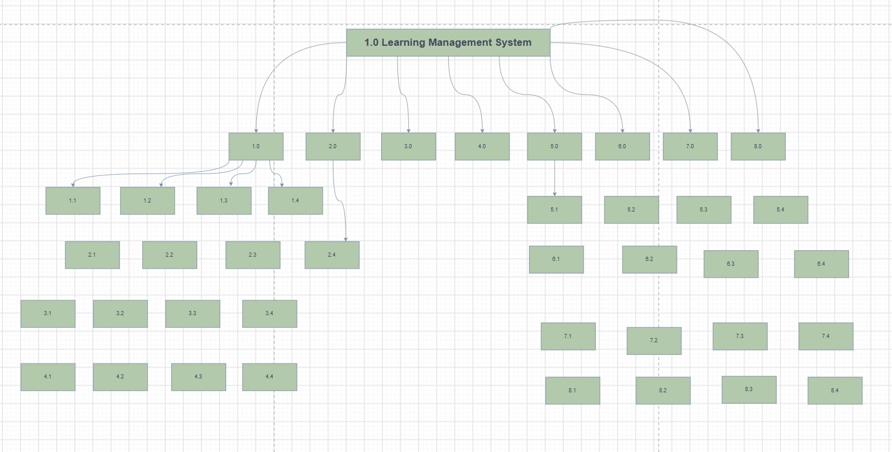
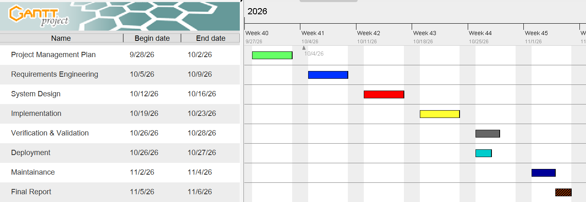
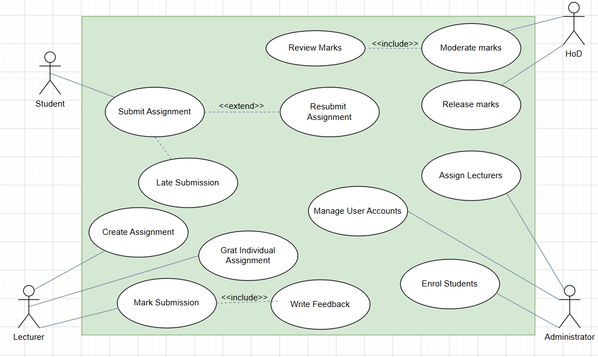

# Abstract

This project develops a moderated Learning Management System for a secondary school whose computers are limited and whose internet connectivity cannot be assumed. It follows the Waterfall life cycle with V-Model verification/validation, as required by the National University of Lesotho CS4433 individual assignment. Four categories of school user—Student, Lecturer, Head of Department and Administrator—authenticate to a local C++17 console application and operate on an SQLite database. The administrator controls staff and student accounts, course assignment and enrolment. Lecturers configure assessment deadlines, authorise individual extensions and provide marked feedback. Students may submit or replace on-time work and inspect only released assessments. Departmental HoDs review marks, reject mistakes for re-marking and approve releases. The grade-calculation policy deducts 10% of the available mark per late day for up to three days and assigns zero after that, while still storing late submissions. Every grade adjustment is auditable.

The report preserves the student's submitted planning, requirements and layered architectural decisions, completes the omitted Phase 3 design artefacts and documents the implemented Phases 4–8. The v1.1 change request permits a lecturer to extend the deadline of an entire class and shows the effective deadline on the student's assignment list without cancelling a later individual extension. The local CTest executable reports 15 passing test groups. GCC gcov measures 96.86% of 637 instrumented physical lines in the formatted `src/lms.cpp`, with no claim of full branch coverage. Limits—including absent school acceptance sign-off, unmeasured 50-session capacity, no hosted CI evidence, and a public service timestamp parameter that must not be exposed to untrusted clients—are stated to avoid misrepresenting prototype readiness.

# 1. Introduction

## 1.1 Problem context and objectives

The project responds to the case study of a secondary school that needs assessment workflow controls while retaining simple, offline operation. The school must protect assessment information from premature disclosure, avoid untraceable changes and allow teachers to manage exceptional deadlines. A straightforward grade-book application is inadequate because the mark exists in distinct states: the lecturer has entered it, the HoD has moderated it and the school has authorised student disclosure. The system therefore needs an explicit lifecycle, access rules and a durable record of changed grades. Its main aim is not to provide every feature of a large commercial LMS; the assignment rules out online payments, video calls, plagiarism checking, automated assessment and web/mobile interfaces.

The engineering objectives are to implement authentic C++17 object orientation, demonstrate inheritance and polymorphism through the four user types, encapsulate the late policy using Strategy, persist data with constrained SQLite tables, apply role restrictions, test the critical assessment paths and maintain a versioned change request. The test plan follows a V-Model mapping: requirements are validated by system/acceptance scenarios, design is checked through integration, and individual business policies are verified through unit tests. The user interface remains a console application as specified by the student's original Phase 3 rather than being replaced with a GUI, web application or network server.

## 1.2 Scope, method and deliverables

The target deployment is a protected school computer with a local database. The application can operate without a network connection after dependencies and executable are installed. Staff and students use individual login credentials. Assignment content is text in this prototype, avoiding binary upload infrastructure and the security issues of arbitrary attachments. A teacher can enter or adjust a raw mark and written feedback; the system computes the grade after the late penalty. An authorised HoD must moderate the result before release. The project separates a documented v1.0 base workflow from the v1.1 perfective feature requested in Phase 8.

The development plan has eight phases. The student's original submitted files are preserved unchanged in `original_phases/`, providing evidence of the first phase decisions and the original use case. This integrated report reexpresses those choices, completes Phase 3's detailed design requirements, and then explains the source, tests, quality controls, deployment, maintenance and ethical responsibilities. Where an engineering artefact is referenced by file path, the actual file is supplied in the accompanying project archive. This includes editable `.puml` diagrams, corresponding PNGs, SQL schema, source, test code, CI workflow and evidence logs. The application is a demonstration-grade prototype until institutional operations and security gaps are addressed.

# 2. Phase 1 — Project Planning and Management (10 marks)

## 2.1 Feasibility and recommendation

The submitted feasibility study recommended proceeding with a lightweight offline console application written in C++17 with an SQLite data store. **Technical feasibility** is supported by availability of free compilers, CMake, SQLite, OpenSSL and unit-test tooling. The implementation uses local storage, so unreliable internet does not interrupt normal marking or student submission after installation. **Operational feasibility** depends on readable prompts and role-specific commands. This approach reduces visual complexity for school staff, although the school should verify that non-technical users can complete routine tasks without assistance. The console is cheaper to maintain than a custom web server and directly supports the case-study scope.

**Economic feasibility** follows from avoiding subscription/cloud fees and using existing school computers and open-source dependencies. The major expense is development, support and the time teachers spend learning the commands. **Legal feasibility** requires controls over learner data and assessment records. Because the likely school jurisdiction is Lesotho, the appropriate local primary reference is the Data Protection Act as published in 2012; South Africa's POPIA should not automatically be substituted merely because it was mentioned in the preliminary Phase 1 plan. **Schedule feasibility** is conditional on the project's seven-week window and the Gate 2 rule: design approval is needed before implementation. The conclusion is to proceed as a single-host system, with limitations identified before operational deployment rather than obscured.

## 2.2 Work breakdown, schedule and critical path

The student's submitted Work Breakdown Structure separates planning, requirements, system design, implementation, verification, deployment, maintenance and final reporting. The included Gantt schedule places planning in the first week; requirements in weeks 1–2; detailed design in weeks 2–3; implementation in weeks 4–5; testing in weeks 5–6; deployment in week 6; and maintenance, completion and viva preparation in week 7. This respects the assignment's phase-gate principle. Milestones include Gate 1 (requirements agreement), Gate 2 (design approval and permission to implement), Gate 3 (verification/validation review), v1.0 and v1.1. A critical dependency chain is requirements approval → design approval → executable implementation → integration/system testing → baseline release → CR1 implementation/regression → final package. Delays on this chain cause corresponding delivery delays unless work is legitimately resequenced within the Waterfall restrictions.

{width=90%}

{width=90%}

## 2.3 Risk management and gates

Six risks were assessed in the submitted Phase 1 register using exposure `likelihood × impact`, with each dimension on a 1–5 scale. **R1 scope creep from conflicting requests** had 4 × 4 = 16 and required formal change control and early conflict resolution. **R2 underestimated moderation complexity** had 3 × 4 = 12, requiring early validation of rules and prioritisation of Must requirements. **R3 SQLite degradation at 800 students** had 2 × 4 = 8, mitigated through parameterised queries, appropriate indexes and performance testing. **R4 password-storage vulnerability** had 3 × 5 = 15, mitigated by using a recognised cryptographic library and security review. **R5 developer unavailability** had 3 × 5 = 15, requiring complete work notes and contingency arrangements. **R6 misunderstanding late penalty/extension semantics** had 3 × 4 = 12 and required documented interpretation and boundary testing.

At Gate 1 the major residual concerns were R1 and R6: the principal's release embargo took precedence over the lecturer's desire to show marks immediately; school late penalties were made precise and extensions allowed. At Gate 2 design control reduced R2 through an explicit state machine and `LatePenaltyStrategy`, and R4 through a salted hash format. At Gate 3 the remaining technical concerns were tested grade visibility, audit reliability and penalty correctness. The updated register in the appendix adds unresolved R7 (public service time argument and reliance on host clock), R8 (50-session performance) and R9 (unaudited host-level database edits). These are especially important because tests can establish algorithmic correctness without demonstrating safe use in a real school environment. Exposure values are working estimates; they are not measured probabilities.

# 3. Phase 2 — Requirements Engineering (14 marks)

## 3.1 Stakeholders and conflict resolution

The original Phase 2 identifies six stakeholder groups: principal, lecturer, HoD, student representative, IT officer and administration. Each prioritises a different dimension of the same workflow. The principal values control and usability, the lecturer fast return and flexible deadlines, the HoD departmental oversight and strict deductions, students fair resubmission and written feedback, IT officers offline reliability and protected credentials, and administrators manageable accounts and course membership. The core dispute is the lecturer's wish for immediate publication against the principal's prohibition on pre-moderation disclosure. The agreed business rule is that the lecturer may record and edit a provisional grade but **only the HoD can release it**, at which point students see the approved score and comments.

The second conflict is between the HoD's punitive late schedule and the student representative's concern that late work must not simply be refused. It was resolved by accepting late work, flagging it, and calculating a grade penalty (zero after three days), rather than refusing storage. Students may replace a submission before the individual effective deadline; this replacement updates the current submission row. A lecturer may grant a documented individual extension that shifts the penalty and resubmission boundary. The offline requirement is resolved through a locally installed executable and database rather than the internet. Security and performance are to be mostly invisible to nontechnical staff; the application must authenticate safely and return understandable errors.

## 3.2 Requirements baseline and verification

The student's Phase 2 SRS has **17 Must functional requirements**, recorded here as `FR-01` through `FR-17` in the order written in the original document. These cover login (FR-01); administrator account CRUD (FR-02), lecturer/course enrolment (FR-03) and department/course management (FR-04); four-role access restriction (FR-05); assignment creation (FR-06); individual extensions (FR-07); student submission/resubmission (FR-08); late policy (FR-09); marks/feedback (FR-10); HoD review (FR-11) and release (FR-12); released student results (FR-13); mark change audit (FR-14); enrolled assignment listing (FR-15); offline operation (FR-16); and salted password hashes (FR-17). The proposed Phase 8 additions are `FR-18` class extension and `FR-19` visible effective deadline and source. These identifiers formalise the originally unnumbered rows and are carried consistently into `docs/traceability.csv`.

The Must non-functional baseline requires 800-user login within two seconds, responsiveness of user actions within two seconds at up to 50 concurrent local sessions, protected password storage, full offline usability, complete mark-change audit, zero high-severity SQL injection warnings and graceful error handling. The Should usability goal is 90% nontechnical user completion of a login/assignment/submission flow within five minutes after reading the guide. These are measurable criteria, not aspirational adjectives. Performance and usability criteria must not be claimed met without appropriate timing or observed participants; they are carried as unresolved verification obligations in the project matrix. The 50-session target, in particular, may require a supervised shared-host design or an approved server layer, beyond the current single-host console prototype.

## 3.3 Use cases, exception paths and acceptance criteria

The original use case diagram connects Student to Submit Assignment and Resubmit Assignment; Lecturer to Create Assignment, Grant Individual Extension, Mark Submission and Write Feedback; HoD to Review/Moderate/Release marks; and Administrator to Manage Users, Assign Lecturers and Enrol Students. The planned system also includes department/course management and results visibility. Three fully dressed use cases are important because they provide direct acceptance-test sources. **Submit Assignment:** preconditions are authenticated student, enrolment and existing assignment. Main flow selects the assignment, displays due/max-mark details, accepts nonempty text and stores timestamp and Submitted/Late status. Alternative flows allow pre-deadline replacement and first-time late submission; exception flows reject invalid content or handle a database error without crashing. Postcondition: durable row with deadline-derived status. **Grant Individual Extension:** authorised lecturer selects enrolled student and assignment, chooses a deadline later than the original and records a reason; an invalid date or nonexistent student is rejected. Postcondition: a student-specific due date appears in the assignment list and governs late penalties. **Moderate and Release:** HoD in the correct department reviews a Marked record, approves/adjusts with a reason or rejects for re-marking; all changes are logged. Release of the course results makes approved feedback visible to the respective students only.

{width=89%}

The acceptance criteria derived from these use cases are observable: before release, `releasedMark` returns no value; after an authorised release, it returns the moderated mark and feedback for the appropriate student only. A wrong-department HoD cannot alter the grade. A submitted student's replacement before deadline does not create a duplicate row. Work one second after a deadline is accepted and is penalised by 10% of the maximum; work one second after 72 hours is stored but graded zero. A successful audit record for a mark change includes the actor, previous/new values and explanatory reason. The requirements traceability appendix identifies each corresponding design operation, table, source file and test group; the original Phase 2 document remains available unchanged in the project package.

